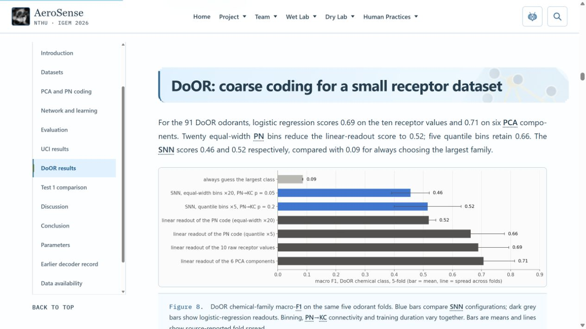

# Notion 模型更新、英文版與正式發布審查

本輪已完成並發布。正式 Wiki 為 `45e61f4f0a50556e6685ebc5dde4d0ccdd79c526`，官方 pipeline **796593** 成功；Software 為 `f04fa0527881bc1d50952afb9d61fef0d4529291`。本紀錄更新於 2026-10-21，日期只屬交接與審查紀錄，不加入 Results 正文。

## 已完成的內容

| 範圍 | 完成內容與核對方式 |
|---|---|
| Model | 依 Notion 的完整 150 個區塊更新 UCI 六氣體、DoOR 五類氣味、編碼、網路、評估及 Test 1 對照；主文約 1,939 英文詞、9 張科學圖，完整參數另列補充資料。 |
| Engineering | 依 31 個 Notion 區塊整理三個模型 DBTL 循環，約 823 英文詞、3 處圖表引用；保留原有 wet lab／hardware 循環。 |
| 圖片 | 11 張不重複的 Notion 科學圖已上傳 iGEM；Model Figure 7 與 Engineering Figure 2 共用同一張來源圖。引用文章的果蠅解剖圖沒有重用，另製作原創概念示意圖，保留生成紀錄與 AI 署名。 |
| 原有證據 | 舊模型圖表、影片及互動內容保留在可展開的補充紀錄；沒有用新模型數據覆蓋另一個研究的結果。原 Results、Hardware、Registry 已完成的分析維持。 |
| 分析說明 | Measurement 補上 UCI-270、DoOR 的評估方法；站內搜尋可直接找到新模型及工程循環。 |
| 全站英文 | 移除翻譯切換、繁中語料、翻譯載入器及建置階段，包含教育遊戲與共享介面。研究原件的原始語言不改寫。 |
| 作者備註 | 依使用者最新指示，略過 Notion 末尾的作者／編輯備註；既有 Attributions 及署名未因此變動。 |

正式頁面：[Model](https://2026.igem.wiki/nthu/model#odor-decoding-summary)、[Engineering](https://2026.igem.wiki/nthu/engineering#group-model)、[Measurement](https://2026.igem.wiki/nthu/measurement)。

## 發布與驗證

- Wiki 的 source-check、client、pages 三項官方工作全部成功，編號為 1920418、1920419、1920420。官方發布 artifact 為 2,894,562 bytes。
- 正式網站 **283／283** 核對通過：255 個 CI 檔案與 28 個路由，包含 67 個 HTML 請求；27／27 clean-route base 正確。本次 31 次新 HTTP 讀回、252 項沿用相同內容雜湊的既有證據，不把未重新下載的內容寫成新下載。
- 新增 Software 文件及擷取程式連同 manifest 共 **5／5** 公開完整 GET 與提交內容雜湊相符。Software 現有 1,254 份研究來源，12,105,891 bytes。
- 教育遊戲 **189／189** 測試通過、各 workspace 型別檢查通過；85 份 JavaScript 語法及 123 份 CSS 解析通過。既有 `contribution.css` 第 2550 行多餘大括號未在本輪改動，已記錄為原有問題。
- 本機 598 份日常來源與官方 Wiki source 一致；28 頁、227 個發布依賴檢查通過。非 Model／Engineering 的 26 頁媒體序列、25 頁表格，以及遊戲邏輯與數值均保持。
- 實際瀏覽器核對 Model 桌面與手機、Engineering 循環切換與展開、搜尋、Measurement、遊戲。補充互動圖搬移後出現的初始化錯誤已修正；正式版 Train & test、Teacher off 均正常，更新的腳本沒有 console error。

主要證據：[官方 CI](official-ci-796593.json)、[正式內容讀回](official-wiki-deployment-readback-796593.json)、[Software 讀回](software-publication-readback.json)、[瀏覽器核對](browser-qa.json)、[正式互動圖核對](published-neural-compatibility-qa.json)。

## 媒體、外部連結與整理

目前網站使用的 **742 個官方 static URL 全部有核對證據**，其中原有 730 個加上 11 個科學圖與 1 個新示意圖。15 種 Video Universe URL 對應 **12 支 Public／Published 影片**。未發現外部 runtime 依賴或 Google Drive 文件連結；論文、社群及來源參考等一般外連與載入網站資源分開審查。Notion 來源連結保留作引文，這次內容、圖片與可編輯紀錄已另存官方及研究包，網站不依賴 Notion 載入圖片。

已清除日常區 131 份退役翻譯檔、官方來源副本的 131 份對應檔，以及經雜湊確認的舊發布輸出和本輪重複擷取／檢查暫存。保留唯一的研究原件、目前有效發布輸出、Git repository、原始 AVI 及有用途的證據收據。網站副本與獨立研究包有不同用途，不當成重複備份合併。

**清理例外仍存在：先前 83 份刪除目標曾被自動審核拒絕，本輪未重試或繞過，仍保留。** 它們包含 2 份 `.pyc`、17 份 upload staging、16 份來源重複工作副本、48 份測試工作檔。這份紀錄不宣稱所有暫存都已清空；目前收據未提供可進一步確認的拒絕理由。

GitHub 階段副本完全未動。本輪詳細媒體證據見 [媒體核對](final-media-evidence.json)，英文版與清理見 [完成紀錄](../english-only-20261021/completion-report.json)。

## Zenodo 研究包

新增來源、11 張科學圖、原創圖、可編輯稿件、擷取程式及出處／發布紀錄共 **30 個 canonical 檔案，4,268,734 bytes**，全部完成雜湊核對，位於 `zenodo-release/aerosense-wiki/data/notion-model-2026-10-21/`。目前主清單記錄 7,854 個唯一 payload、24,970,813,295 bytes、8,214 筆來源映射；此數值是註冊時的快照，已保留同時發生的研究包導覽整理與其他新增資料。

研究包仍是**本地未發布**狀態，沒有假稱新的 Zenodo DOI 或全部原始資料已公開。官方 Software 提供可編輯文件與現有程式；保存 Notion 稿件與圖不等於取得新版 SNN 的完整訓練程式。

證據：[研究包註冊](archive-package-registration.json)、[原創圖生成紀錄](original-pathway-generation.txt)、[原創圖官方讀回](original-pathway-public-readback.json)。

## 嚴格科學審查

下列區別已反映於正文、caption、方法、討論或資料可用性，不能只為較好看的結果而省略：

1. 新 UCI-270 六氣體研究、DoOR 五類氣味研究與舊 KT/UCI 五氣體結果分開。感測器資料、文獻受體資料和 AeroSense 細胞量測不能視為同一批資料。
2. UCI 訓練曲線最高觀察值為 0.83，800 cycles 為 0.79，中途 400 cycles 降至 0.53；沒有改寫成全程穩定 0.8。分層 probe 的五折按 measurement 分組，1,799 次 presentation 不是 1,799 個獨立量測。
3. DoOR SNN 的 0.46 到 0.52 同時改變分箱、連接率與訓練長度，不能單獨歸功於分箱。PCA／logistic regression 基準保留，沒有只展示較有利的比較。
4. Model Figure 9 使用 **Test 1** 的校正峰值分率，不是 Test 2 或 VUAA1 比值。來源報告 39 組受體／氣味相關分析，pooled r = −0.18、p = 0.28；沒有宣稱證實跨平台受體一致。
5. 圖上的 ±0.043 是來源所報參考帶，沒有提供可驗證推導，不能當作生物重複的信賴區間。每個受體／氣味條件是一個 well。
6. 新稿件未提供相符的完整訓練引擎、fold IDs、隨機種子、checkpoint、完整特徵／輸出匯出及相關分析程式。因此目前能追溯圖文與現有程式，**尚不能獨立重跑全部新模型數值**。沒有虛構這些材料。
7. 現有 hardware backend 是四受體 Pearson 參考圖樣比較，沒有改稱部署完成的 PN–KC–MBON 網路。原創示意圖及互動動畫是概念解說，並非實測神經活動。

完整逐項依據：[科學與 criteria 核對](criteria-and-scientific-review.json)。

## 獎項與交件判定

| 項目 | 嚴格判定 |
|---|---|
| Bronze | 官方 Wiki、Software、Registry 證據可讀；Contribution、Attributions 路徑存在。必要交件仍須全部完成，不能單憑頁面存在判定獲獎。 |
| Silver | Engineering 提供具體迭代與測試；HP 依前輪紀錄保留。本輪沒有改寫使用者排除的 HP 正文。最終仍由評審判定工程與負責任實踐的品質。 |
| Gold | 選擇 Model、Hardware、Education 跨 General Bio Engineering 與 Specialization，組合符合類別要求。是否達標取決於三項實際品質，無法保證金牌。 |
| Best Model | 資料、架構、基準比較及工程選擇更完整；最主要待補是新版模型可獨立執行的重現材料。外部資料的分類結果不能取代裝置對香蕉真菌的驗證。 |
| Best Hardware | 既有實體測試、工程文件、設計回饋與重現資料保留；要區分標準品、細胞探索量測與完整生物應用效能，不把 backend 整合寫成端到端驗證。 |
| Best Education | 既有教材、雙向學習紀錄與遊戲保留，英文操作可用；活動參與量不等同學習成效，不替使用者發明前後測或額外成果。 |

官方交件頁本輪讀取顯示 **Judging Form：Saved → Received；Attributions：Saved → Received**，優先於早期 Not Started 草稿記錄。本代理沒有按 Judging Form 的最後提交。Project Safety 保留先前 Final Submitted／Awaiting Review 狀態，兩份 check-in Approved。

**Presentation Video 仍為 No Submission，官方列出期限為 2026-10-28 23:00 臺灣時間。** 影片已在 Video Universe 公開不等於完成該交件欄位。

官方依據：[Medals](https://competition.igem.org/judging/awards/medals)、[Special prizes](https://competition.igem.org/judging/special-prizes)、[Deliverables](https://competition.igem.org/deliverables/)。

