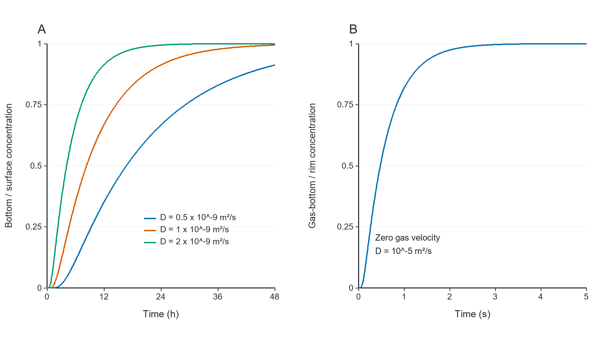

# 01_gas_and_liquid_times

## Publication caption

One-dimensional diffusion steps with no membrane or reaction. (A) Exact bottom concentration for the confirmed 8.929 mm liquid depth at three assumed liquid diffusivities. The surface is fixed immediately; this is not measured cell response. (B) An isolated 3.571 mm gas layer, with its mouth instantly fixed and its bottom impermeable, has t90 approximately 1.315 s at zero velocity and assumed D=10⁻5 m²/s. It excludes upstream wash-in and liquid uptake; it is not the approximately 149 s inlet-to-rim CFD result. The panels have different time units.

## How to read

Hours versus seconds: gas arrival and dissolved delivery are different processes.

## Assumptions and limits

The8.929mm liquid column is confirmed; D values, stagnant liquid and instantly fixed liquid surface are assumptions. No model of cell uptake, binding, mixing or GCaMP.

## Source data and reproduction

`results/liquid_depth_sweep.csv`, `results/summary.json`.

`python run.py --plots`

See [Analysis](../Analysis_EN.md) for equations,units,sources and assumptions.
