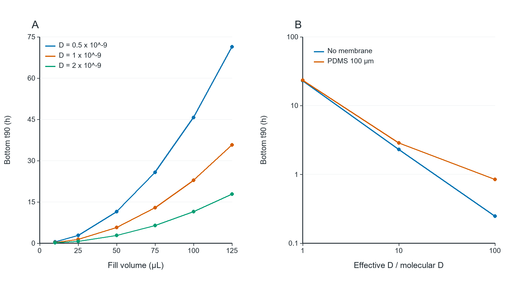

# 02_depth_and_mixing

## Publication caption

Sensitivity to liquid-path assumptions. (A) Bottom t90 scales quadratically with fill volume at fixed11.2mm² area; only100µL is the confirmed operating condition. (B) Effective liquid D multipliers are mixing proxies, not computed flow. The100µm film uses assumed D_PDMS=10⁻10m²/s,K_PDMS=100,K_liquid=10. Membrane resistance becomes more visible when liquid transport is faster.

## How to read

Volume reduction and mixing are hypothetical sensitivities; this figure does not authorize changing the100µL working protocol.

## Assumptions and limits

The effective-D multiplier is an empirical proxy. No stirring speed, cell shear or new CAD was solved.

## Source data and reproduction

`results/liquid_depth_sweep.csv`, `results/mixing_feed_sensitivity.csv`.

`python run.py --plots`

See [Analysis](../Analysis_EN.md) for equations,units,sources and assumptions.
