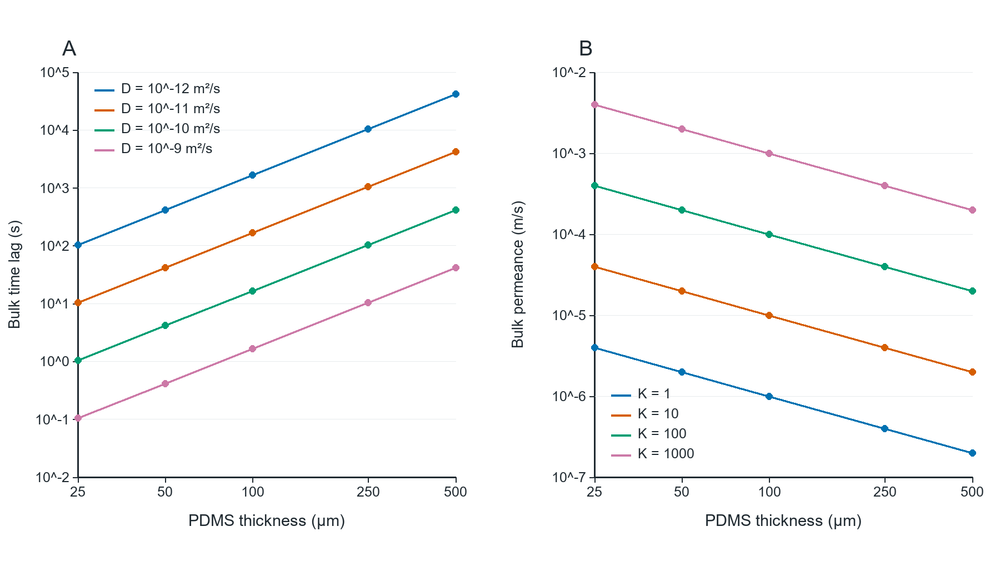

# 03_intrinsic_PDMS

## 可供引用的圖說

25–500 µm體相溶解–擴散敏感度，不是膜選型結果。(A) 假設D下的L²/(6D)延遲，不等於井底t90。(B) D=10⁻10 m²/s、四個假設PDMS／氣相K下的濃度型導度DK/L。此圖未納入表面阻力、膨潤與混合物效應。

## 如何閱讀

把厚度造成的延遲和透過導度分開看；D與K雖分開掃描，實際材料未必能獨立調整。

## 假設與限制

此圖是理想介面，25 µm端尤其可能受省略的表面阻力影響；另有surface_resistance_sensitivity.csv測試此不確定性。

## 原始資料與重跑

`results/intrinsic_properties.csv`.

`python run.py --plots`

參閱[分析報告](../Analysis_ZH.md)的方程、單位、來源與假設。
