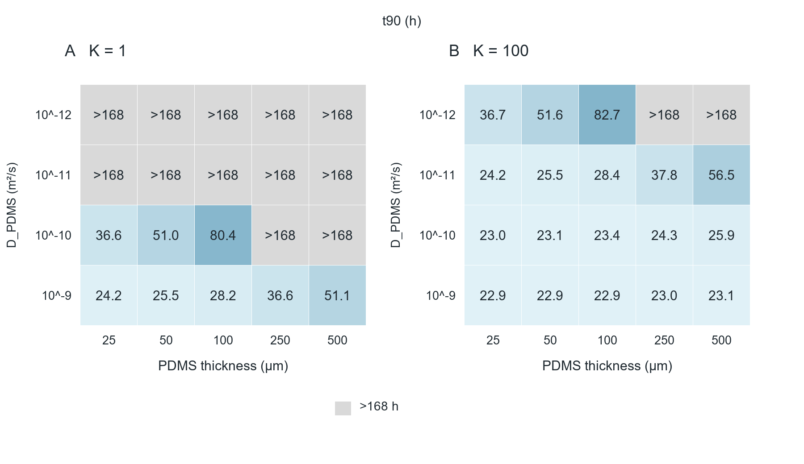

# 04_PDMS_coupled_sweep

## Publication caption

Bottom t90 for a PDMS–gas–liquid stack at100µL,D_liquid=10⁻9m²/s,K_liquid=10. (A) K_PDMS/gas=1. (B) K_PDMS/gas=100. Rows are assumed PDMS diffusivity; columns are membrane thickness. Cell numbers are hours; gray cells did not reach90% within168h. These are illustrative inputs, not measured properties of a VOC or curing ratio.

## How to read

The displayed40 cells are a slice of243 conditions. A gray cell is censored, not zero delivery. There is no universal best thickness without target properties.

## Assumptions and limits

Prescribed rim step,100µL, no liquid convection/reaction and constant linear partitions. Long mathematical horizons do not establish cell stability.

## Source data and reproduction

`results/membrane_sweep.csv`.

`python run.py --plots`

See [Analysis](../Analysis_EN.md) for equations,units,sources and assumptions.
