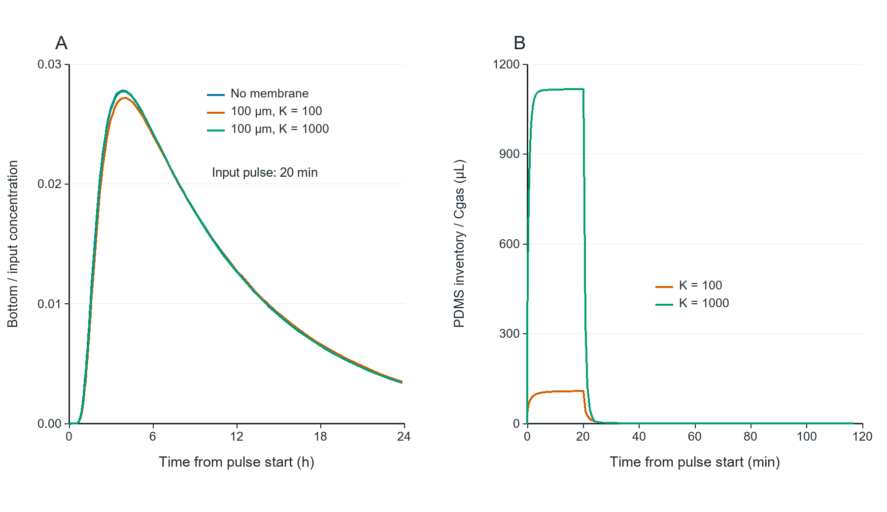

# 05_pulse_and_storage

## Publication caption

A20-minute prescribed gas pulse in the representative100µL stack. (A) Bottom concentration normalized by K_liquid times input gas concentration; the broad peak occurs after the input has ended. (B) Reversible PDMS inventory divided by input gas concentration, reported as gas-equivalent volume per well. D_PDMS=10⁻10m²/s,D_liquid=10⁻9m²/s,K_liquid=10. No irreversible adsorption or receptor adaptation is modeled.

## How to read

Near-overlap of some bottom curves is a result, not missing data. Higher K increases both permeability and stored analyte, so response delay need not increase.

## Assumptions and limits

A20-minute square pulse, linear reversible partitioning, fixed material properties and no chemical/receptor kinetics. This is not a measured washout schedule.

## Source data and reproduction

`results/pulse_histories.csv`, `results/case_summary.csv`.

`python run.py --plots`

See [Analysis](../Analysis_EN.md) for equations,units,sources and assumptions.
