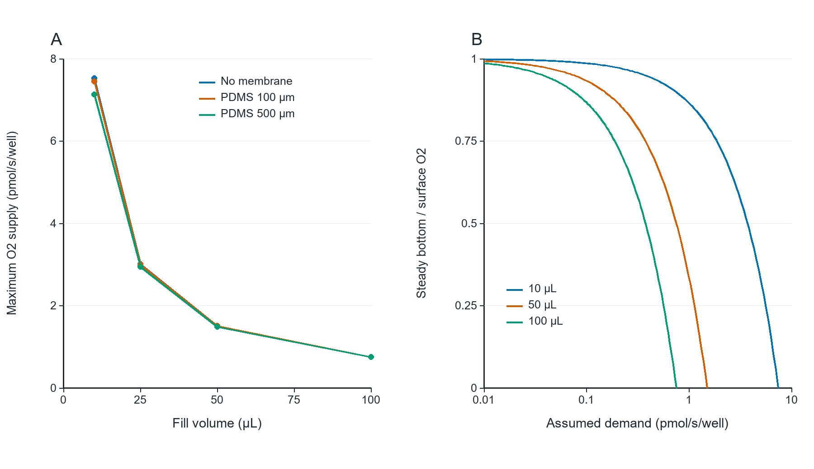

# 06_oxygen_capacity

## Publication caption

Illustrative oxygen-transport capacity at293K, not a viability prediction. Published reference PDMS P/D are combined with assumed liquid D=2×10⁻9m²/s and surface O2=0.30mol/m³. (A) Maximum steady supply to a zero-concentration bottom. (B) Constant-demand bottom fraction for100µm PDMS; curves terminate when assumed demand reaches transport capacity. Loads are not measured HEK293T respiration rates; gas/medium control and37°C conditions are not validated.

## How to read

The zero-concentration-bottom value is an optimistic capacity ceiling. Compare with measured demand only after temperature, medium and gas supply are known.

## Assumptions and limits

PDMS data are at293K; liquid D and0.30mol/m³ O2 are assumptions. Neglected cell dynamics, surface resistance and external films can lower delivery.

## Source data and reproduction

`results/oxygen_capacity.csv`, `results/summary.json`.

`python run.py --plots`

See [Analysis](../Analysis_EN.md) for equations,units,sources and assumptions.
