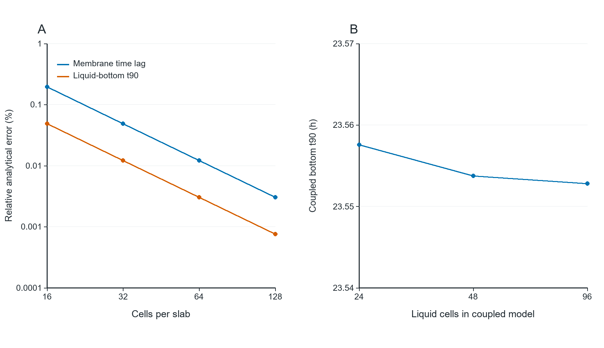

# 07_numerical_validation

## Publication caption

Implementation checks. (A) Spatial refinement of membrane time lag and liquid-bottom t90 against analytical solutions. (B) Representative100µm PDMS–gas–liquid model with1mL/min mixed-reservoir feed;48→96 liquid cells changes t90 by approximately0.00405%. Time evolution uses a matrix exponential. Small numerical error does not validate assumed material properties or biological performance.

## How to read

Read error percentages, not biological confidence. Refinement confirms this discretized model converges toward its analytical benchmark.

## Assumptions and limits

Different layers and the finite reservoir are included in panelB; the agreement does not measure real membrane D/K or validate gas-to-cell sensing.

## Source data and reproduction

`results/numerical_validation.csv`, `results/coupled_convergence.csv`, `results/validation.json`.

`python run.py --plots`

See [Analysis](../Analysis_EN.md) for equations,units,sources and assumptions.
