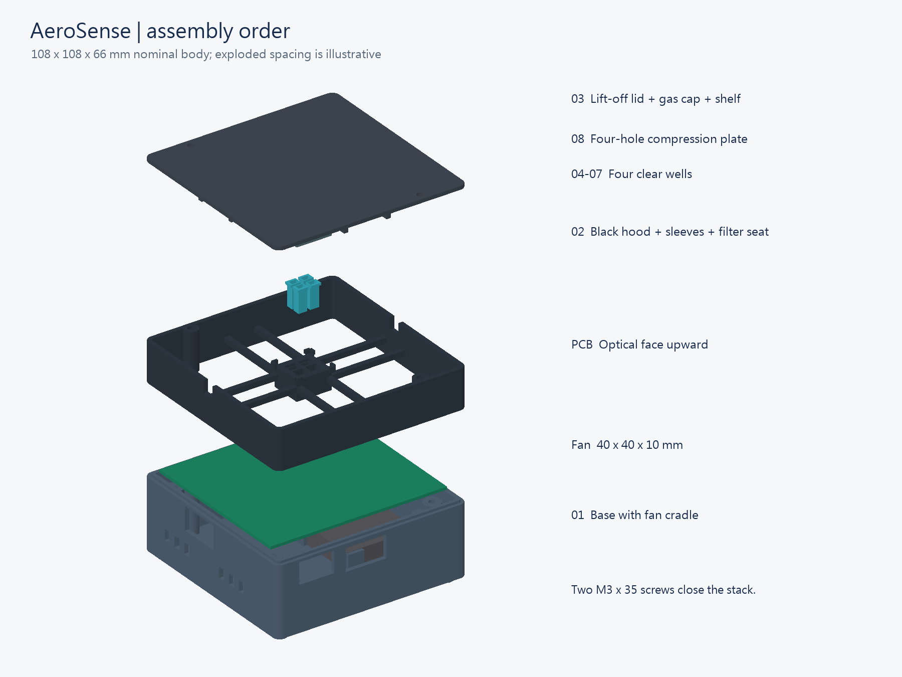
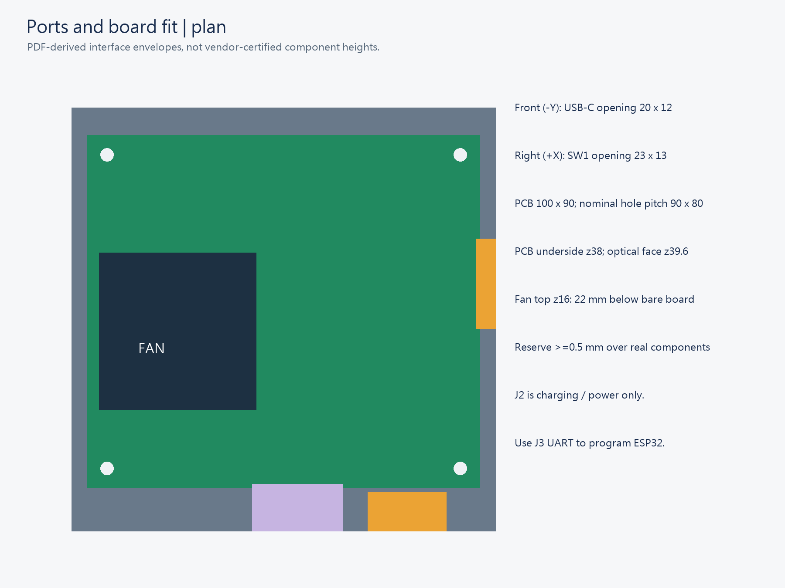
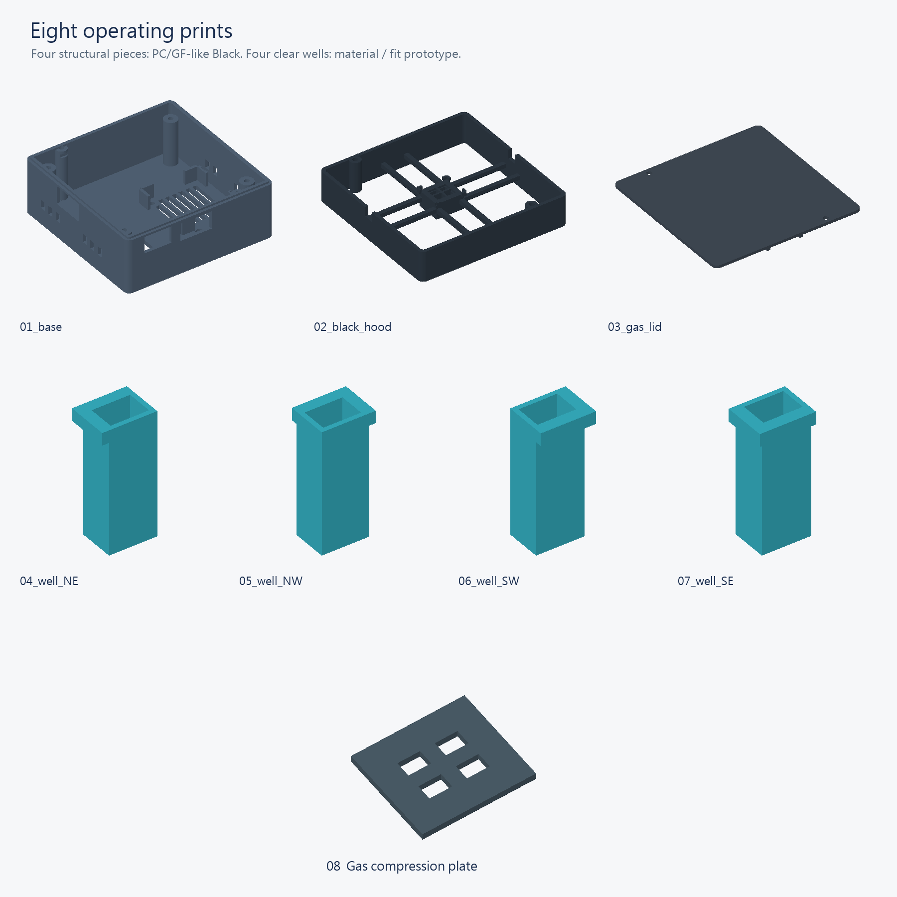
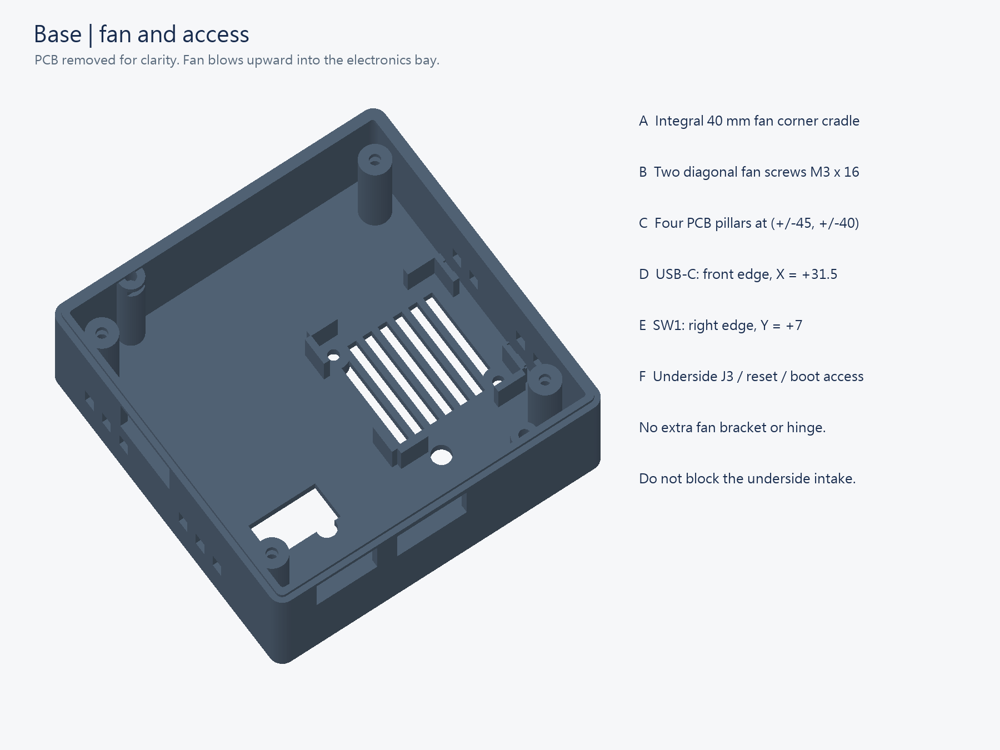
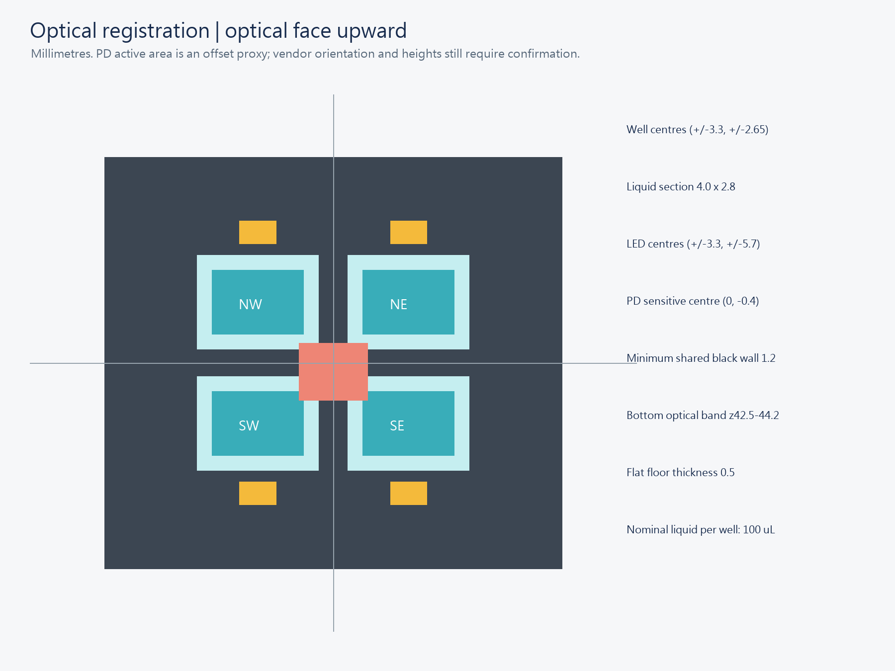
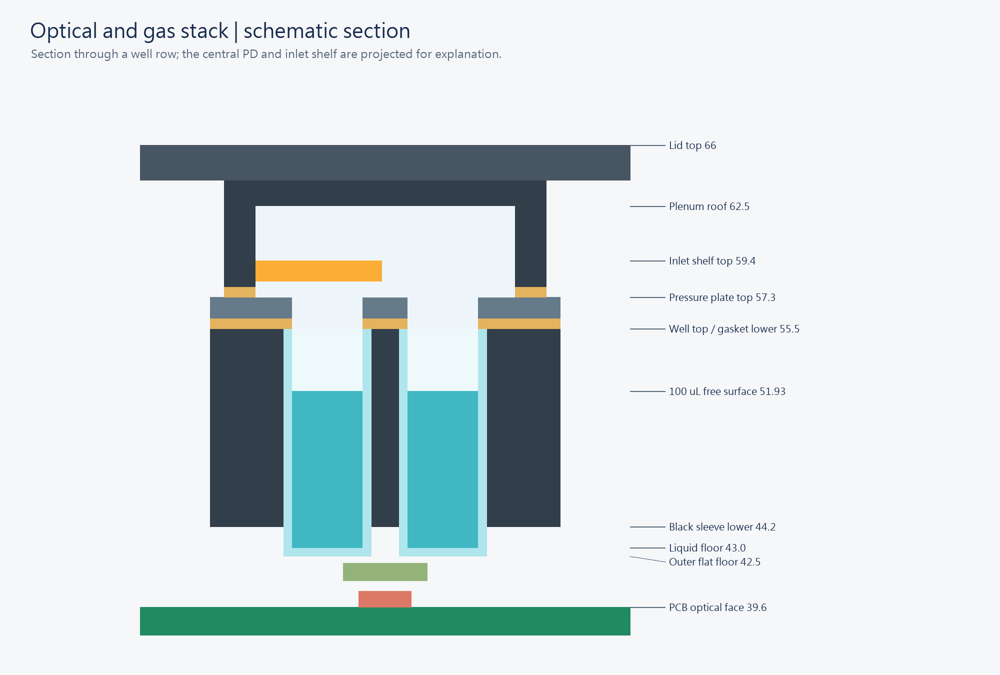
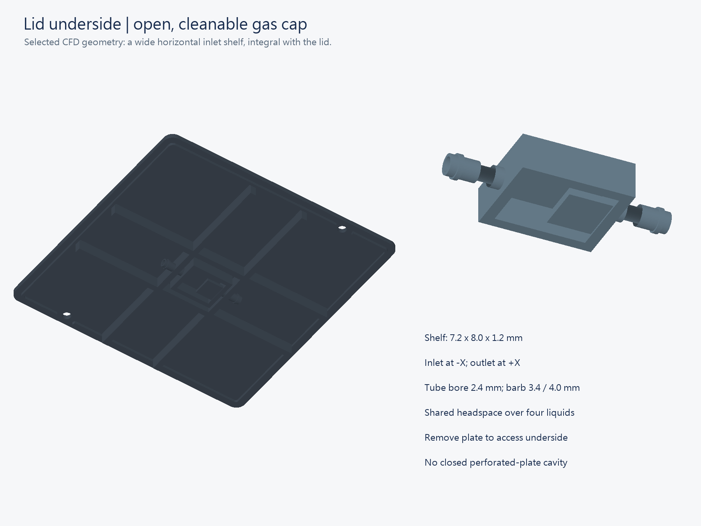

# AeroSense 圖解組裝手冊

本手冊說明八件列印件、PCB、光學密封與氣管的組裝。先完成無細胞試裝，再進行通電與液體測試。日期：2026-10-08。

英文採 ASD-STE100 第 9 版的寫作原則；中文為對照的步驟式說明。文件未經完整詞彙與語法符合性審查，不宣稱正式符合 ASD-STE100。每節的「準備、步驟、確認、異常處理」分開閱讀。

這是工程原型。CAD 尺寸不等於實板或列印量測。外形約 108 × 108 × 66 mm，不含螺絲頭、軟管及外接濾器。四井液體分開，氣相相通。系統沒有細胞溫度、CO2、濕度控制，也沒有自動氣閥。

## 1 準備零件與工作區

準備：乾燥托盤、游標卡尺、鑷子、2.5 mm 內六角扳手、下列零件及 05_BOM 的詳細表。接觸樹脂與生物樣本時，使用實驗室規定的防護與處理方法。

| 件號 | 數量 | 材料或規格 | 用途 |
|---|---|---|---|
| 01 | 1 | Rigid PC/GF-like Black | 底座與風扇座 |
| 02 | 1 | Rigid PC/GF-like Black | 黑色遮光罩 |
| 03 | 1 | Rigid PC/GF-like Black | 氣蓋，內含一體式擋板 |
| 04 至 07 | 各 1 | Aqua Clear Plus | NE、NW、SW、SE 四個 well |
| 08 | 1 | Rigid PC/GF-like Black | 四孔壓板 |
| H01 | 4 | M3 × 8 mm | PCB 固定 |
| H02 | 2 | M3 × 16 mm | 風扇固定 |
| H03 | 2 | M3 × 35 mm | 蓋子固定 |
| H04 | 8 | M3 × 0.5 標準六角螺帽 | 上述八支螺絲 |
| H05 | 6 | M3 平墊片，厚 0.5 mm | PCB 四片、風扇兩片 |

M3 螺絲採圓柱頭內六角規格，長度不含頭部；不能直接換成沉頭螺絲。M3 螺帽對邊 5.5 mm、厚 2.4 mm。墊片內徑 3.2 mm、外徑 7 mm。金屬墊片與銅箔之間的絕緣仍須確認。

1. 關閉 SW1。

2. 拔除 PCB 的外部電源。

3. 取出電池。

4. 將八件列印件依件號排在托盤上。

5. 將螺絲依三種長度分開。

確認：只使用 01_print 內的現行八件 STL。不要混用 STL old 的底座與現行上殼。開發工具可借用；未來展望項目不屬於本次組裝。

## 2 量測實板與外殼間隙

準備：PCB 斷電，光學面朝上。座標的前方為 USB-C 所在的 −Y 側；SW1 在 +X 側。BOTTOM 圖可能鏡像。以實板與廠商圖確認方向。

1. 量測 PCB 外形。

2. 量測四個固定孔的中心距。

3. 量測板厚與下方焊點突出高度。

4. 量測電池座含電池的最大高度。

5. 量測 LED、PD、C21、R27、U8 的最高點。

6. 量測 ESP32 超出板邊的長度、寬度與下方高度。

7. 將結果填入 fit_checks.csv。

| 介面 | CAD 名義值 | 確認方式 |
|---|---|---|
| PCB 與固定孔 | 100 × 90 mm；孔心 (±45, ±40) mm | 與實板逐一比較 |
| PCB 高度 | 底面 Z38；假設板厚 1.6 mm | 四支柱同時支撐 |
| 下方空間 | 一般區 32 mm；風扇區 22 mm；螺絲頭上約 18.5 mm | 扣除元件高度後至少保留 0.5 mm 試裝餘量 |
| well 外底面 | Z42.5；距名義光學板面 2.9 mm | 不得壓到 LED、PD 或被動元件 |
| USB-C 孔 | 中心 X31.5；寬 20；Z28.5 至 40.5 mm | 用實際線材試插 |
| SW1 孔 | 中心 Y7；寬 23；Z27.5 至 40.5 mm | 確認全行程不卡 |
| 天線孔 | 寬 23；Z27 至 39.6 mm | 還要檢查垂直放入路徑 |

確認：天線垂直放入時，板外突出量僅有 7.2 mm 的名義容許空間。PDF 圖示约 6.54 mm，只剩 0.66 mm 名義餘量。這不是經確認的模組外形。若碰觸上緣舌片，立即抬起 PCB。不可壓天線、磨 PCB 或扳元件。

現行 SW1 孔相較舊印件：下緣低 5.5 mm、開孔中心低 3 mm，左右外壁各內縮 3 mm。這些是 CAD 差異，並非實物已通過試裝。記錄位置：[fit_checks.csv](../07_validation/templates/fit_checks.csv)。

## 3 檢查列印品質

1. 將切片單位設為 mm。

2. 將縮放設為 100%。

3. 依已驗證的樹脂流程完成清洗。

4. 依同一流程完成後固化。

5. 檢查光學底面是否平整且無裂紋。

6. 檢查管孔是否完全暢通。

7. 清除密封面、螺帽槽與配合面上的支撐殘留。

8. 量測 well、插槽與密封面。

確認：well 名義液體截面為 4 × 2.8 mm，平底厚 0.5 mm。支撐不要放在光學底面或密封面。不可用整體縮放來修正單一配合，也不要自行磨薄光學底。Aqua 8K Gray 不在本次選定材料中。

透明、黑色或完成固化，都不代表已通過細胞相容性、遮光或滅菌驗證。不得直接假設列印件可高壓滅菌。

## 4 安裝風扇

準備：01、40 × 40 × 10 mm 風扇、M3 × 16 mm 兩支、M3 螺帽兩個、0.5 mm 墊片兩片。固定孔距為 32 mm。風扇供電位置尚須廠商確認。

1. 將兩個螺帽放入底座下方的對角六角槽。

2. 將風扇放入底座的四角定位座。

3. 將風扇氣流箭頭朝向 PCB。

4. 在每支 M3 × 16 mm 螺絲套上一片墊片。

5. 將螺絲穿過風扇孔並旋入螺帽。

6. 交替鎖緊兩支螺絲，直到風扇不移動。

7. 將線材沿外殼邊緣固定。

8. 檢查葉片周圍是否有線材。

確認：風扇平放、外框不變形、螺絲尖端不低於底腳。名義單側空隙為 0.3 mm，但風扇尺寸公差可能減少餘量。若卡住，停止組裝。風扇不得由 ESP32 GPIO 直接供電。這個風扇不負責樣本給氣。

## 5 安裝 PCB

1. 將四個 M3 螺帽放入 PCB 支柱側槽。

2. 將另外兩個 M3 螺帽放入前後上蓋固定柱。

3. 將 PCB 光學面朝上。

4. 將天線對準前方開口。

5. 緩慢放低 PCB。

6. 檢查下方元件與風扇之間的空隙。

7. 在四支 M3 × 8 mm 螺絲各套上一片墊片。

8. 將四支螺絲各旋入約兩圈。

9. 以對角順序逐步鎖緊螺絲。

10. 將實際 USB-C 插頭插到底。

11. 操作 SW1 的完整行程。

12. 拍照記錄四角支撐與介面位置。

確認：PCB 不彎曲，四角都有支撐，天線不受力，線材不被夾住。J3、SW2、SW3 可接近。若墊片碰銅箔、元件接觸外殼或插頭推動 PCB，停止。不要靠鎖緊螺絲消除碰撞。

完成後，使用相同手機、距離與方向，分別測試開殼與關殼約兩分鐘的連線。記錄開始、停止與漏收資料。這只檢查預定使用距離，不能宣稱 RF 認證。

## 6 安裝濾片與遮光罩

準備：02、已確認光譜與外形的螢光濾片，以及 0.8 mm 不透明矽膠片。濾片最大尺寸 5.2 × 4.2 × 1.0 mm。一般大尺寸成品濾片不能直接放入。

1. 將遮光罩倒放在乾淨托盤上。

2. 將濾片平放在中央濾片座。

3. 檢查濾片沒有遮住設計通光孔。

4. 依原尺寸模板裁切 PD 密封片。

5. 將密封片放在 PD 周圍。

6. 檢查密封片開孔對準實際 PD 感光窗。

7. 將遮光罩轉回正常方向。

8. 緩慢將遮光罩放在 PCB 上。

9. 檢查 C21、R27、U8、LED 與遮光罩的空隙。

PD 密封片外框 4 × 4 mm、內孔 3 × 3.4 mm。厚度由 0.8 mm 名義壓至 0.6 mm。PD 感光中心在模型 (0, −0.4) mm，不是封裝中心；方向須以實際標記確認。最窄邊僅 0.3 mm，裁切偏移會遮住感光面。

使用 [1 比 1 密封片模板](../09_engineering_sources/CAD/drawings/gasket_cut_template_1to1.svg)。列印原 SVG 後量測尺寸。Word 內縮放過的圖不能直接當裁切模板。若需黏著固定濾片，先確認膠材；僅在不透光邊角施作，避免污染通光面。

確認：遮光罩可自行就位，不需螺絲拉下。硬列印件不得壓住 LED 或 PD。綠色透明片不等於合格螢光濾片。光譜阻擋與高入射角表現尚須確認。

## 7 安裝 well 與密封堆疊

準備：先用空井。使用 04 至 07、08、下層四孔密封片及上層框形密封片。四個 well 的幾何未變更。

1. 將四個 well 放入各自的 NE、NW、SW、SE 位置。

2. 將每個 well 的凸緣朝外。

3. 檢查四個 well 的平底都朝下。

4. 檢查四個凸緣頂面等高。

5. 放入下層四孔密封片。

6. 將四個孔對準井口。

7. 將 08 壓板放入角落導引位置。

8. 放入上層框形密封片。

9. 檢查所有密封面無毛屑與皺褶。

下層密封片：外框 20 × 18 mm，孔 4 × 2.8 mm，孔心 (±3.3, ±2.65) mm。上層密封片：外框 18.4 × 15.6 mm、內孔 14.8 × 12 mm。兩片厚度均為 0.8 mm，各名義壓縮 0.2 mm。壓板厚 1.2 mm；凸緣頂面名義 Z55.5。

確認：每井可用鑷子輕取，不需硬塞。名義單側配合餘量為 0.15 mm。不能省略壓板，否則蓋子可能沒有均勻壓住井口。若凸緣不等高，停止並記錄差值。

液量：你回報實物約 100 µL 已滿，因此本手冊以 80 µL 作為待確認的工作量。先在機器外用水量測實際容量，再做蓋合測試。若溢出或弄濕密封面，減少液量。CAD 的 140 µL 幾何估值不能作為操作上限。既有 100 µL 模擬沒有因本次文件更新而重新計算。

## 8 接氣管與關蓋

準備：03、M3 × 35 mm 兩支、相容的軟接管、PTFE 管、進出口各一個疏水氣體濾器。03 已含水平擋板，不另裝孔板。四井共用氣路。

1. 將氣蓋放在托盤上。

2. 從蓋內擋板辨認進氣側。

3. 在外側標記 IN 與 OUT。

4. 支撐第一個列印接頭的根部。

5. 將軟接管輕套在接頭外側。

6. 用相同方式接第二個接頭。

7. 將軟管分別穿過遮光罩左右側孔。

8. 連接進氣濾器與樣本管。

9. 連接排氣濾器與受控的下游抽氣設備。

10. 停止抽氣設備。

11. 保持出口可通氣。

12. 緩慢放下蓋子。

13. 將兩支 M3 × 35 mm 螺絲旋入底座螺帽。

14. 交替鎖緊，直到蓋子接觸設計止擋面。

15. 檢查側孔內的軟管沒有被夾扁。

接管順序：樣本 → 進氣濾器 → IN → 四井共用腔 → OUT → 排氣濾器 → 一個受控抽氣設備 → 實驗室核准排放處。CAD 中 IN 是 −X，OUT 是 +X；翻轉蓋子後不要只憑左右辨認。

接頭外徑 3.4 mm、凸環 4.0 mm、內孔 2.4 mm。軟管套在外面，不插進內孔。可用套接長度約 4.8 mm，之後有補強肋。不要強推硬 PTFE 管或扭轉脆接頭。側孔約 7 × 7 mm；保留開蓋所需彎曲餘量。軟管內徑、外徑與材質須實際試配。

確認：進出口暢通、蓋縫均勻、井口沒有液體。0.2 µm 疏水氣體濾器是設計要求；市售 0.22 µm 參考品不代表已完成滅菌或阻菌資格確認。若採用參考品，須確認用途、壓降、接頭與 VOC 回收。

## 9 做無細胞確認

1. 在 PCB 外進行每井 80 µL 的水試裝。

2. 擦乾 well 外側與井口。

3. 依第 7 與第 8 節重新組裝。

4. 以受控低流量啟動完整氣路。

5. 量測包含管路與濾器的實際流量。

6. 觀察液面是否有飛濺、濕邊或氣泡。

7. 記錄外部是否漏液。

8. 停止氣流。

9. 依操作手冊做暗場與螢光標準測試。

模型候選流量為 3 mL/min，屬於 100 µL 模擬條件；不代表 80 µL 或細胞安全性已驗證。不要用泵的最大抽力直接抽密封井。若濾器濕掉、液面上升或流量不穩，立即停機。氣流設定見 [Flow Operation](../02_simulation/airflow/Flow_Operation_EN.md)。

## 10 更換 well 與處理異常

1. 按 UI 的 Stop / LEDs off。

2. 確認裝置已停止量測。

3. 停止抽氣。

4. 保持出口可通氣，直到壓力平衡。

5. 關閉 SW1。

6. 卸下兩支上蓋螺絲。

7. 消除外部軟管的拉力。

8. 垂直抬起蓋子。

9. 取下上層密封片。

10. 取下壓板。

11. 取下下層密封片。

12. 用鑷子夾凸緣取出 well。

13. 檢查裂紋、殘膠、密封片變形與濕濾器。

異常處理：若液體到達 PCB，立即斷電並依實驗室程序清理；不可擦過就重新通電。若上蓋合不上，逐一檢查凸緣、密封片、導槽、螺帽與管線。不得用更長螺絲強壓。更換 well、液量、濾片、細胞批次或 duty 後重新校正。

如需確認操作與燒錄，使用同資料夾 Operation_and_Setup 的 Word 或 PDF。對外發表時，把試裝、量測結果與模型預測分開標示。文字規則依據：[ASD-STE100 官方網站](https://www.asd-ste100.org/)。
