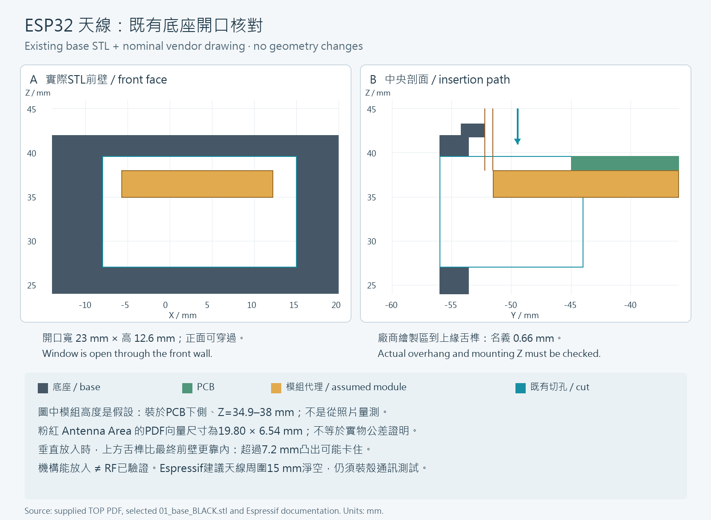

# ESP32 天線開口與組裝間隙核對

稽核日期：2026-10-06。對象：目前交付的底座 STL、CAD 與廠商 TOP 圖。這是名義幾何核對，尚未證明實板一定能放入，也不是射頻模擬。

**目前底座已有穿透前壁的天線開口，不能因為照片看到天線凸出 PCB 就判定必須改殼。真正需要優先量測的是組裝路徑：依廠商圖的天線區，垂直放入時到上方舌榫只有約 0.66 mm 名義間隙。** 本次沒有修改 CAD 或任何 STL；8 個 STL（包括已開始列印的 4 個 well）與先前保存的 SHA-256 全部相同，well 中心、外形與接口均未變更。

## 1. 開口與天線如何對應

使用既有「光學面朝上」暫定座標，PCB 前緣為 Y = −45 mm、底面 Z = 38 mm、光學面 Z = 39.6 mm。廠商 TOP 圖需鏡射 X 才能對應此座標；實板方向仍需確認。所有數值單位為 mm。

| 項目 | 目前幾何／來源 | 意義 |
|---|---|---|
| 底座天線開口 | X −8～15；Y −56～−44；Z 27～39.6 | 寬 23、高 12.6；切孔穿過前壁 |
| 前壁 | 外面 Y −56；內面 Y −53.6 | 壁厚 2.4；PCB 前緣到內壁 8.6 |
| 上方舌榫 | 前方內緣 Y −52.2；Z 41.8～43.3 | 垂直放板先通過此位置；容許的名義凸出量僅 7.2 |
| 廠商粉紅 Antenna Area | X −6.649～13.151；Y −51.540～−45.000 | PDF 向量區域約 19.80 × 6.54；不是實物尺寸公差證明 |
| 圖上天線區至最終前內壁 | 約 2.06 | 最後定位的平面名義距離 |
| 圖上天線區至舌榫內緣 | 約 0.66 | 垂直放入的平面名義距離；更嚴格的限制 |

廠商 BOM 的 U4 為 ESP32-WROOM-32E，官方外形尺寸為 18 × 25.5 × 3.1 mm，使用 PCB 天線。19.80 mm 是廠商圖上所畫的區域寬度，與模組 18 mm 實體寬度不是同一種量。將兩者混用會得到不可靠的配合結論。[Espressif 模組資料表](https://documentation.espressif.com/esp32-wroom-32e_esp32-wroom-32ue_datasheet_en.pdf)

本圖中的模組高度暫以 PCB 下側 Z = 34.9～38 mm 示意；實際焊接間距、板厚、零件朝向與總高度尚未量測。照片可以證明天線區確實凸出，不能提供足以核定配合的毫米尺寸。

## 2. 最後位置能容納，不代表能直接垂直放入

既有切孔頂端到 Z = 39.6 mm，上方 Z = 41.8～43.3 mm 的舌榫仍保留。因此，板子下降到最後高度以前，凸出的天線先經過較窄的舌榫開口。檢查器對廠商圖上約 6.54 mm 的凸出量所得垂直射線無碰撞；以 7.4 mm 凸出量作對照時，同一方向的射線會碰到舌榫。

0.66 mm 是理想圖面差值，**尚未扣除列印收縮、翹曲、焊接位置與定位誤差**。現階段不能把它寫成「實板保證不撞件」。若以實物至少 0.5 mm 淨間隙作為本專案的暫定機構驗收目標，名義上只剩約 0.16 mm 的誤差餘裕；0.5 mm 也只是工程驗收目標，不是 Espressif 的射頻要求。

拿到實板後只需先完成下列核對：

1. 用卡尺量 PCB 前緣到天線最外端的凸出量，以及天線／模組的實際寬度、左右位置。以 PCB 邊緣作基準，避免從照片推估。
2. 量 PCB 板厚與安裝後模組最低點；核對模組是否位於示意的 PCB 下側。先確認板的正反面與左右方向。
3. 斷電試放，觀察經過上緣舌榫與最後定位時的間隙。不要硬壓、彎折天線或靠傾斜強行通過；傾斜路徑尚未驗證，可能讓其他元件碰撞。
4. 若實測不足，先針對底座天線區與舌榫評估局部修整／改圖，重新檢查強度與組裝路徑。此份稽核沒有實施這種修改，也不需要先改動 4 個 well。

## 3. 機構開口與無線通訊是兩項不同驗證

Espressif 建議把模組 PCB 天線放在主板邊緣外，並提醒外殼會影響天線：外殼內天線周围建議至少 15 mm 各方向淨空，最終產品仍需做吞吐量與通訊距離測試。天線凸出主板本身符合常見的配置方向，不能剪除。[Espressif 模組位置與外殼指南](https://docs.espressif.com/projects/esp-hardware-design-guidelines/en/latest/esp32/pcb-layout-design.html#general-principles-of-pcb-layout-for-modules-positioning-a-module-on-a-base-board)

目前緊湊殼體的舌榫／前壁距離遠小於 15 mm，**尚不符合這項外殼淨空建議；穿透開口不能當作 RF 合格證明**。這也不等於已證實無線一定失敗。樹脂的介電常數、損耗及列印實物狀態未知；不能僅由黑色外觀認定它導電或屏蔽無線訊號。

保留天線附近的無金屬與無電線區，先以固定手機／路由器位置、相同方向與相同韌體，比較裸板與完整裝殼後的連線成功、連線中斷／資料遺失和傳輸表現；RSSI 可輔助記錄，但不能單獨證明通訊可靠。若需要對外宣稱通訊距離，必須用實測數據補上。

## 4. 尺寸圖與檢查證據



圖 A 是目前底座 STL 前表面投影，X 為左右、Z 為高度；圖 B 是名義 Y–Z 中央剖面。灰色為底座、綠色為 PCB、黃色為假設模組包絡、青色為既有切孔及下降方向。所有座標是 mm；圖片不是 1:1 列印量規，黃色高度不是實測結果。

[Evidence JSON](Antenna_Clearance_Evidence.json) 記錄 336 條穿過開口內部的前向射線均無 STL 相交，開口四周與舌榫的 5 組實體對照均命中，並列出垂直插入的兩組射線結果與 8 個 STL 的 SHA-256。這是抽樣射線核對，沒有涵蓋連續體積、所有插入角度、全部元件或完整公差堆疊。

## 5. 重現方式

在完整交付資料夾中使用 Python、numpy、Pillow、pypdf，並安裝可顯示中英文字的字型，執行：

```text
python 09_engineering_sources/CAD/checks/Antenna_Clearance_Check.py
```

[檢查器](Antenna_Clearance_Check.py) 讀取選定底座 STL、[參數](../design_parameters.json)、[CAD 原始碼](../aerosense.scad)、[保存紀錄](current_preservation.json) 與原廠 TOP PDF，從 PDF 向量路徑重新抽取天線區。只會輸出本頁的 Evidence JSON 與兩張尺寸圖，不會匯出或改寫 STL。若資料／雜湊已改變，檢查會停止，應重新稽核，不能為了讓檢查通過而直接更新保存紀錄。

若使用不含廠商原始 PDF 的公開精簡附件，須先取得有權使用的原始 `08_reference/NTHU-TEST_BOARD_V1-TOP-0911.pdf`，才能重現其向量抽取；不可將缺少來源的照片推估當作等價輸入。

[English edition](Antenna_Clearance_EN.md)
