# AeroSense Model — archived manuscript copy

Source record: [Model (2), team Notion record](https://jealous-ragdoll-815.notion.site/3f5256561ff881dc9639e30f58948e42).

Snapshot: the 10 October 2026 publication record, preserved locally from `reports/notion-v5-source/model-v5-published-manuscript.md`. This website copy was prepared on 11 October 2026; the original snapshot and Notion were not changed.

**Version boundary.** This is an archived manuscript, not the current interpretation. The [current Model page](../../model.html) adds the 11 October geometry, quantization-clock and reproducibility corrections: the physical fill observation may invalidate the assumed headspace; the affected bit-precision results require a corrected-clock rerun; the KT thesis identity, raw-data permission and matching decoder code remain unverified. Historical claims below must be read with those corrections. Later cross-validation figures do not establish that the clock error was corrected.

**Host nomenclature.** The team identifies its experimental host as HEK293. Any HEK293T spelling in this website copy is normalized to HEK293; this is an editorial correction, not new authentication evidence. The original archival source remains unchanged.

The local relative page links below point to this website. Source files and numerical results retain their original provenance; no new fit, measurement or replication was added.

---

# AeroSense — Model

## Abstract

We use independent computational studies to examine physical measurement and response decoding. Conditional optical transport predicts NE detector collection of 0.593 ± 0.035 nW; gas transport identifies a sampled 3 mL/min candidate with worst gas-interface t90 of 50 s, while a separate liquid model leaves delivery to bottom-attached cells unresolved. A fly-inspired PN–KC–MBON network classifies KT metal-oxide recordings with random-split five-fold macro-F1 0.87 ± 0.03, decreasing to 0.73 on unseen days. Layerwise probes localize the largest measured loss to the learned readout. On an independent 36-month UCI corpus, reference-gas correction raises cross-batch SVM accuracy from 33% to 58%. These results prioritize physical calibration, diverse collection schedules and error-driven learning; SNN cross-batch robustness and biological odor classification remain to be demonstrated.

## Introduction · transport and measurement before decoding

The reader must first transport sample gas and preserve fluorescence. These physical models ask whether the current geometry can deliver gas to the liquid interface, collect emitted light and separate desired signal from interference. They inform a build candidate; they do not validate a working instrument.

The [Decode track](../../model.html#evidence-snapshot) is a separate KT and UCI metal-oxide sensor study. Its updated KT random-split macro-F1 is 0.87 ± 0.03 across five folds, and approximately 0.73 under whole-day holdout. These are neither AeroSense cell results nor outcomes reproduced by the physical-model package.

[01 / LIGHT**Which photons reach the detector?**Geometry, sampled paths and optical mixing →](../../model.html#optical-transport)[02 / GAS**How does the sample reach the wells?**Flow fields, wash-in and operating choice →](../../model.html#gas-and-liquid-transport)[03 / LIQUID**When can molecules reach the cells?**Depth, diffusion and the membrane hypothesis →](../../model.html#liquid-transport)

**Version boundary.** These simulations retain their original 100 µL fill. The latest manual's provisional 80 µL working volume follows the team's physical fill observation and has not been simulated. The CAD geometry and all eight operating STLs are unchanged. See [Hardware · fill and assembly status](../../hardware.html#mechanical-package).

## Where excitation and fluorescence can go

The Monte Carlo geometry contains four registered wells, a finite offset photodiode, a finite emission filter and specified resin/liquid interfaces. Excitation and fluorescence packets are scored separately at nominal wavelengths of 470 and 520 nm. The reference source is a 20 µm layer at the well floor with absorption 0.5 mm−1, quantum yield 1 and 500 µW LED-on power. Ideal clear resin is an explicit assumption, not a measured material specification.

### Geometry and transport assumptions

The solver follows packets across **rectilinear material boundaries**, with Fresnel reflection and total internal reflection. It does not trace arbitrary STL triangles. The four well cavities are 4 × 2.8 mm; the floor is at Z = 43 mm and the 100 µL meniscus at Z ≈ 51.93 mm. LED centers are (±3.3, ±5.7) mm; each has a 1 × 0.3 mm Lambertian emitting area and no lens.

The PD is a 3 × 2.5 mm equal-area proxy for a 7.5 mm² sensitive area, centered at (0, −0.4, 40.5) mm. The 5.2 × 4.2 × 1 mm filter is a homogeneous absorptive proxy. Refractive indices are 1.0 for air, 1.333 for liquid and 1.5 for resin; resin scattering and parasitic absorption are omitted. Actual detector geometry, filter angle response and printed-resin optics need measurement.

Collected power is scored as **LED power × absorbed fraction × quantum yield × (470 / 520) × collection fraction**. This separates excitation absorption from the probability that a fluorescence packet reaches the finite detector.

Optical paths and modulated detector tracesOriginal simulation · 20 s · 0.49 MBThe movie loads only when you press Play.

**100× slow motion:** 0.2 s of modulation is shown over 20 s. Panel A displays saved **NE sample trajectories only**; the four LED indicators and ideal, conditional received and residual traces share one clock. Paths switch with LED state: they are not simulated photon flight times. Traces use green-equivalent nW. No calcium response, measured PCB timing or fabricated paths for the other wells are included. [Original MP4 ↗](../../hardware%20information/AeroSense%20v2/02_simulation/optics/optical_slow_motion.mp4) · [Source timing and scope](../../hardware%20information/AeroSense%20v2/02_simulation/optics/results/video_metadata.json).

| Calculation | Sampling | Interpretation |
| --- | --- | --- |
| Main optical sweep | 24 conditions × 3 seeds; 24,000 excitation + 60,000 emission packets / seed | 6,048,000 packets; seed variation estimates Monte Carlo sampling uncertainty |
| Floor irradiance | 600,000 excitation packets | Spatial illumination, not a measured light field |
| Collection map | 224 positions × 65,536 isotropic-source packets | Finite detector acceptance, not a detector calibration |
| Additional LED / filter study | 12 conditions × 3 seeds; 3,024,000 packets | Per-LED excitation rejection assumptions |

The NE reference yields **0.593 ± 0.035 nW** at the ideal detector (mean ± one SE across three seeds). Intended-well shares span **88.6–90.9%** across LED rows; NE floor CV is **46.2%**. The mixing-matrix condition number is approximately 1.86. The SE excludes uncertain LED power, resin optics, detector orientation, filter-angle response and cellular expression.

Current optical sensitivity study. Every comparison uses the stated geometry and source assumptions; error bars represent finite Monte Carlo sampling.

[View the floor maps, well-transfer result and resulting calibration design in Hardware →](../../hardware.html#optical-floor-result)

### Interpret the power and spatial results separately

For the same reference assumptions, LED-on collected powers are NE 0.593, NW 0.723, SW 0.829 and SE 1.008 nW. These are not the recovered AC amplitudes: at 25% duty, the time average is 0.25 times the on-state power and the fundamental amplitude is approximately 0.450 times it. The NE floor mean upward irradiance is 4.366 µW/mm² with CV 46.2%; this is neither all-direction fluence nor a prediction of cell distribution.

About 32% of collected NE fluorescence reflects after emission and remains useful signal. Artificial detector acceptance cones retain only 19.3% within 45° and 64.8% within 65°. The photodiode's quoted half-sensitivity angle is not a hard cutoff, so material and angular characterization are needed before converting this model to a detector specification.

Detector-angle and geometry sensitivity under the idealized transport model. Do not interpret a datasheet half-sensitivity angle as an acceptance cutoff.

#### Numerical checks · conservation, uncertainty and incomplete paths

The main sweep contains 6,048,000 packets. Reported uncertainty is the three-seed mean ± one Monte Carlo SE, not a 95% confidence interval or a bound on real-device uncertainty. The 224-position collection map has a median relative SE of 17.3%.

Analytic solid-angle, normal-incidence Fresnel, total-internal-reflection, scattering and material-location checks accompany the implementation. Maximum energy-ledger discrepancy is 2.9 × 10−15. At the 2,500-event limit, up to 0.0117% of paths remain unfinished; the worst conservative unresolved green-power bound is approximately 0.121 nW in an individual run. Extra NE runs compare 2,500 and 10,000 events; they do not establish global convergence of every geometry.

[Validation record](../../hardware%20information/AeroSense%20v2/02_simulation/optics/results/validation.json) · [Publication checks](../../hardware%20information/AeroSense%20v2/02_simulation/optics/results/publication_validation.json) · [Complete numerical interpretation](../../hardware%20information/AeroSense%20v2/02_simulation/optics/Analysis_EN.md)

#### Why a fluorescence standard uses a different model

A uniform sodium-fluorescein solution emits throughout the well volume, whereas the reference cell model emits in a thin bottom layer. Compare the planned standard experiment with the homogeneous-volume calculation and its row-normalized matrix. Agreement would support the optical test under those conditions, not an absolute-power calibration, a gas-response claim or the cell-layer assumption.

Separate uniform-volume model for the planned cell-free standard experiment.

[Standard and later cell-comparison guide](../../hardware%20information/AeroSense%20v2/07_validation/Fluorescence_and_Cell_Test_EN.md)

[Complete methods and assumptions](../../hardware%20information/AeroSense%20v2/02_simulation/optics/Analysis_EN.md) · [Primary numerical summary](../../hardware%20information/AeroSense%20v2/02_simulation/optics/results/summary.json) · [Figure-by-figure notes](../../hardware%20information/AeroSense%20v2/02_simulation/optics/Figure_Guide_EN.md) · [Hardware decision →](../../hardware.html#well-floor-results)

## Frequency separation does not remove every background

The desired trace retains modeled green fluorescence, including useful reflected fluorescence and well mixing. The conditional received trace adds per-LED Monte Carlo excitation leakage, assumed ambient light, Poisson photoelectron noise and electronic noise. Units are **green-equivalent nW**, not measured current or voltage.

### From optical power to a synthetic readout

A two-second trace is sampled at 4 kHz with four 25%-duty LED gates. The reference scenario uses the four-LED OD3 leakage calculation, assumed green responsivity 0.3 A/W and blue/green responsivity ratio 0.8. Added ambient light is 0.15 nW DC plus a 0.05 nW oscillation at 100.3 Hz; electronic noise is 0.005 nW RMS per sample. Photoelectron shot noise is sampled in 250 µs bins.

Gate states are held per sample. TIA bandwidth, ADC dynamics, dark current, timing jitter and partial PWM edges are not included. Each noisy trace is fitted jointly at the four tag frequencies to distinguish desired amplitude from synchronous contamination. A signal at an LED's frequency can be excitation leakage as well as fluorescence.

The default scenario gives **2.63–3.52%** amplitude bias after joint four-frequency demodulation and waveform AC SINR **23.40 dB**. A 144-scenario sweep with 32 noise repetitions per condition varies spectral rejection, ambient behavior, noise and responsivity ratio. These are synthetic scenarios; repetitions are not PCB experiments.

[View the frequency-recovery result and readout design in Hardware →](../../hardware.html#readout-background-result)

### Sensitivity across assumed backgrounds

Channel bias and waveform metrics under declared detector assumptions.

144 assumed scenarios × 32 noise repetitions; no measured board noise is inferred.

The 144 conditions vary spectral rejection, ambient behavior, electronic noise and responsivity ratio. Each has 32 noise repetitions, but Monte Carlo mean powers are fixed: these repetitions do not propagate material, biological or optical-sampling uncertainty. LED-synchronous background survives frequency selection.

Spectral filtering and a separately measured blank address different terms. Subtract the illuminated blank once in complex I/Q, preserve raw values and retain the signed phase reference. Fixed subtraction cannot remove random noise or changing interference, and it cannot repair ADC clipping. [The hardware correction workflow](../../hardware.html#electronics-bridge) implements this boundary without automatically applying a simulated unmixing matrix.

[Reproduce the detector analysis](../../hardware%20information/AeroSense%20v2/02_simulation/optics/README_EN.md) · [Signal units and parameter assumptions](../../hardware%20information/AeroSense%20v2/02_simulation/optics/Analysis_EN.md)

### A conditional target for the next measurement

At 500 µW LED-on power, quantum yield 0.6 and a 10% fluorescence change, the stated photon-budget model predicts a **16.03 pW lock-in amplitude change**. A chosen SNR ≥ 5 target would require repeat lock-in RMS below **3.21 pW**. This is an engineering target under those assumptions, not a measured detection limit or an ADC sample-noise requirement.

Photon-budget sensitivity. Changing quantum yield, optical power or fluorescence change changes the target; actual cells and electronics remain to be measured.

## Design the flow, then test gas wash-in

### Velocity model: geometry is the variable

A double-precision D3Q19 BGK lattice-Boltzmann solver screens 18 geometries in 28 original velocity solves: the open plenum, original 12-hole plate, vertical walls, L-shaped hoods and horizontal shelves. Air density is 1.2 kg/m³ and viscosity 1.8 × 10−5 Pa·s. Solid walls and the stationary liquid surface use halfway bounce-back; pressure terminals use non-equilibrium extrapolation.

Saved fields are Stokes-normalized to 1 mL/min. Convergence requires velocity change below 2 × 10−5 over 200 steps and mass imbalance below 0.2% for three consecutive checks. All 28 runs meet the checks; maximum reported imbalance is 0.0444%. A separate near-1 mL/min solve confirms the directional trend.

The momentum proxy is evaluated 1 mm below the well rim; gas-speed P95 is sampled 0.6–1.4 mm above the liquid. These are **gas-side quantities**, not submerged-cell shear, biological response or tissue-injury criteria.

Open plenum, perforated plate and integral shelfOriginal simulation · 20 s · 2.81 MBThe movie loads only when you press Play.

**60 physical seconds in 20 seconds of playback.** Panels A–C advect saved velocity markers in the open, 12-hole and selected-shelf gas geometries at the **1 mL/min baseline**. Marker density is not concentration. Panel D independently plots finite-volume gas concentration for the shelf with Dgas = 10 mm²/s. The liquid remains a stationary boundary; no liquid mixing or cell motion is simulated. This is not a movie of the later 3 mL/min candidate. [Original MP4 ↗](../../hardware%20information/AeroSense%20v2/02_simulation/airflow/airflow_comparison.mp4) · [Source timing and scope](../../hardware%20information/AeroSense%20v2/02_simulation/airflow/video_metadata.json).

### The shelf improves one metric, with a tradeoff

Low-Reynolds-number computational fluid dynamics first compares direction, speed, pressure and gas distribution. The selected shelf reduces the chosen downward momentum proxy by approximately 36.1% and near-liquid P95 gas speed by 20.1% at the finest comparison grid. The CV of downward gas-circulation flux across wells worsens from approximately 0.0098 to 0.369; this is not an odor-concentration CV. Some perforated geometries improve a momentum metric further, but refinement changes rankings and narrow holes create print and cleaning concerns. The current eight STLs retain the integral shelf.

[View the shelf comparison and selected gas-lid design in Hardware →](../../hardware.html#shelf-comparison-result)

### Scalar model: gas concentration is a separate calculation

A conservative cell-centered finite-volume advection–diffusion solver uses backward Euler in time, upwind advection and central diffusion. The inlet steps from zero to normalized concentration 1; the outlet is convective with no diffusive flux. Walls and liquid are impermeable in this gas-only calculation. Projecting face fluxes to a divergence-free field changes the baseline velocity flux by 1.54%.

Three assumed gas diffusivities, 5/10/20 mm²/s, test molecular-transport uncertainty. They are not pump settings. Near-liquid concentration is averaged separately for each well; the four-well worst t90 is used in the operating comparison.

Advection–diffusion then estimates gas concentration near the liquid. The 1 mL/min, Dgas = 10 mm²/s NE baseline has t90 = **149.55 s**. Velocity markers are not molecular concentration, and neither observable measures bottom-cell exposure.

At 1 mL/min and Dgas = 10 mm²/s, the NE baseline t90 is 149.55 s. Gas concentration at the liquid interface is distinct from concentration at bottom-attached cells.

### Choose a sampled operating point against declared criteria

The fixed-CAD study evaluates 21 combinations: 0.25/0.5/1/2/2.5/3/5 mL/min at each of three diffusivity assumptions. The comparison requires worst-well gas t90 ≤ 60 s, port Reynolds number ≤ 3 and near-liquid P95 gas speed ≤ 0.01 mm/s. The speed cap is an engineering comparison criterion, not a measured cell-injury threshold.

Fixed-CAD flow/diffusivity study. Gas diffusivities 5/10/20 mm²/s are uncertain material assumptions; the candidate is the lowest qualifying sampled flow, not a global optimum.

[View the operating-flow result and pump-setting decision in Hardware →](../../hardware.html#operating-flow-result)

| Metric | Computed result | Declared criterion / boundary |
| --- | --- | --- |
| Worst near-liquid gas t90 | 50.00 s | ≤60 s across four wells and three gas-diffusivity assumptions |
| Refined grid / half time step | 50.98 s / 49.85 s | Numerical checks at the chosen candidate |
| Near-liquid gas P95 speed | 0.00280 mm/s | ≤0.01 mm/s engineering comparison cap; not a cell-injury threshold |
| Port Reynolds number | 1.77 | ≤3 in the declared comparison |
| Chamber pressure drop | 0.02737 Pa | Excludes external filters and tubing |
| Nearby 2.5 mL/min point | Worst t90 ≈60.04 s | Numerically borderline; not proven physically inadequate |

The ledger includes 28 original velocity solves (18 geometries), 18 hole conditions plus 2 refinements, 9 baseline scalar conditions plus an analytic benchmark, and 21 operating points plus 6 scalar checks and 1 direct velocity confirmation. Solver counts are not experimental replicates. [The supplemental ledger](../../hardware%20information/AeroSense%20v2/02_simulation/airflow/supplemental_summary.json) and [operating-point record](../../hardware%20information/AeroSense%20v2/02_simulation/airflow/operating_sweep_summary.json) give the exact accounting.

Use one regulated downstream pump and verify actual assembled-path flow; the UI cannot sense or control it. Controlled delivery and time/batch records are motivated by [Vergara et al. (2012)](../../hardware%20information/AeroSense%20v2/08_reference/Gas_Delivery_Reference_EN.md), whose metal-oxide drift study does not validate our gas setting or cell safety. [Hardware implementation →](../../hardware.html#gas-path-results) · [Operating method and assumptions](../../hardware%20information/AeroSense%20v2/02_simulation/airflow/Flow_Operation_EN.md)

#### Explore the 21 computed operating points

Rotate the saved flow-rate/diffusivity study and inspect its values. Gas diffusivity is an uncertain material assumption, not an operator control. The speed cap is an engineering comparison value, not a cell-injury threshold.

[Open document in a new tab ↗](../../hardware%20information/AeroSense%20v2/02_simulation/airflow/operating_sweep_3d.html) 

#### Geometry sweeps and numerical verification

The shelf/open momentum reduction is 30.9%, 30.1% and 36.1% on 0.4, 0.3 and 0.2 mm grids. Local flow metrics are therefore not grid independent. A separate 18-condition six-hole sweep varies diameter (1.2/1.8/2.4 mm), pitch (3.6/4.2/4.8 mm) and plate height (57.9/58.2 mm). Its smallest momentum ratio changes from 0.0246 to 0.0351 on refinement. Narrow holes also introduce fabrication and cleaning tradeoffs; the current STLs retain the shelf.

Exploratory six-hole sweep. This is a comparison set, not an alternate selected print or proof of a global optimum.

The C# and NumPy velocity implementations differ by a relative L2 norm of 3.09 × 10−12; the Hagen–Poiseuille benchmark errors are 2.54% at τ = 0.8 and −1.13% at τ = 0.55. For scalar transport, the mass-ledger discrepancy is 8.65 × 10−12 and the one-dimensional analytic mean-concentration error is 0.000246. Baseline gas t90 changes by about +1.7% with grid refinement and −0.2% with a halved time step. These verify numerical implementation, not the actual apparatus.

[Full solver methods](../../hardware%20information/AeroSense%20v2/02_simulation/airflow/Airflow_Analysis_EN.md) · [Explore the saved hole sweep ↗](../../hardware%20information/AeroSense%20v2/02_simulation/airflow/hole_sweep_3d.html)

## The liquid path remains the unresolved step

The three-dimensional gas model stops at the liquid interface. A separate one-dimensional screening model asks how molecules could travel through the gas gap, an optional membrane and the liquid to bottom-attached cells. At the original 100 µL fill, the liquid is 8.929 mm deep and the gas gap below the rim is 3.571 mm. No membrane is selected for the current eight-part build.

### What is solved, and what is omitted

Define gas-equivalent concentration *u*, partition coefficient *K*, and material concentration *c = Ku*. The layer model solves **K ∂u/∂t = ∂(DK ∂u/∂x)/∂x**, with instant interfacial partitioning, a concentration step upstream and a non-consuming bottom probe. A finite-volume spatial operator and matrix exponential handle the step-forcing solution.

Diffusivities and partition coefficients are generic sensitivity inputs: target VOCs and their measured properties are not established. The model assumes dilute linear transport, constant properties, uniform area and no convection, reaction, binding or cell consumption. It excludes meniscus deformation and leaks. Faster effective diffusion is a mixing proxy, not a demonstrated mixing mechanism.

### Liquid depth can dominate the response time

For an ideal step directly at the liquid surface, no mixing and Dliquid = 10−9 m²/s, bottom t90 is **22.83 hours**. This follows t90 ≈ 1.031105 L²/D; halving the liquid path would reduce that idealized time by a factor of four. The result is a transport boundary case, not a receptor or GCaMP response time.

[View the gas-versus-liquid result and cell-delivery validation in Hardware →](../../hardware.html#liquid-delivery-result)

Across Dliquid = 0.5/1/2 × 10−9 m²/s, the ideal bottom t90 is 45.67/22.83/11.42 h. A shallower 25 µL counterfactual gives about 1.43 h at the middle diffusivity; it is not the selected operating fill. The new provisional 80 µL handling volume has not been rerun through these simulations.

The depth and effective-diffusivity studies locate a transport bottleneck. They do not demonstrate viable cell operation or an implemented mixing mechanism.

### PDMS is a research branch, not an installed solution

The 243-condition study includes 25/50/100/250/500 µm films and no-film controls, membrane diffusivities from 10−12 to 10−9 m²/s, and a broad partition-coefficient grid. Seventy-four conditions do not reach t90 within seven days; missing times must not be read as zero.

Under a representative stagnant-liquid condition, adding a 100 µm film (D = 10−10 m²/s, K = 100) changes the coupled t90 from about 22.85 to 23.39 h. If effective liquid diffusion is increased 100-fold, the respective times are approximately 0.25 and 0.85 h, and the membrane can become the bottleneck. A film can alter delay and recovery; hydrophobicity alone does not establish a water-vapor barrier.

Generic transport sensitivity, not measured VOC permeability. No PDMS film is added to the required BOM on this evidence.

#### Transient forcing, model checks and the next independent measurement

The saved CFD concentration history can drive the layer model in one direction. The source runs to 300 s; at that time the simulated bottom fraction remains below the 10−10 reporting floor. Extending the boundary thereafter as either 1 or its final 0.991144 value gives no-film t90 between 22.87 and 23.62 h. This is not a 23-hour CFD simulation or two-way mass-conserving coupling.

A 20-minute input pulse produces a delayed peak of about 2.78% after 3.92 h in the illustrated boundary case. It shows transport memory under the assumptions, not adsorption, receptor activation or a measured recovery curve.

Transient storage and delayed delivery are consequences of the stated transport model; they are not biological measurements.

The standalone 128-cell membrane check reproduces the analytical time lag within 0.00305%; liquid-bottom t90 differs from the exact series by 0.000762%. Refining the coupled liquid mesh from 48 to 96 cells changes t90 by 0.00405%; worst normalized mass-balance residual is 2.17 × 10−5.

Before selecting a film or claiming rapid sensing, define a target molecule, measure no-film delivery and recovery, then compare a characterized film using an independent concentration assay. GCaMP alone cannot separate transport from receptor sensitivity or optical artifacts.

[Full transport methods and limits](../../hardware%20information/AeroSense%20v2/02_simulation/membrane/Analysis_EN.md) · [Parameter and result summary](../../hardware%20information/AeroSense%20v2/02_simulation/membrane/results/summary.json) · [Back to the build decision →](../../hardware.html#gas-path-results)

## What the models changed

| Question | Evidence | Decision | Remaining measurement |
| --- | --- | --- | --- |
| Does a finite PD collect modeled fluorescence? | MC geometry and acceptance maps | Retain the carrier as a test candidate; preserve filter / PD registration | Blank, dye standard and actual detector/filter characterization |
| Are frequency tags independent wells? | Nonzero off-diagonal optical contributions | Preserve complex channels and measure a mixing matrix | One fluorescent source well at a time |
| Does lock-in reject synchronous excitation? | Per-LED leakage and conditional channel bias | Require spectral rejection and an independent illuminated blank | LED-synchronous background and actual noise |
| Can gas direction change without another part? | Shelf/open comparison, including worse exchange symmetry | Keep the integrated shelf and eight selected prints | Physical flow, pressure and interface delivery |
| Which flow gives useful gas wash-in? | 21-condition fixed-CAD flow/diffusivity sweep | Select 3 mL/min conditionally against declared criteria | Measured assembled-path flow and concentration history |
| Does a capture protein speed cell exposure? | No target-specific uptake or binding records supplied in this package | Retain a separately labeled hypothesis | Identify protein and ligand; measure uptake and release |

[Inspect the resulting apparatus](../../hardware.html#mechanical-package) · [Read the focused physical test](../../hardware.html#validation-boundary) · [How remaining evidence affects adoption](../../entrepreneurship.html#hardware-adoption)

## Capture proteins and docking remain exploratory

The supplied package does not identify a unique capture protein, sequence/accession, structure or reproducible project docking inputs, poses and run logs. The documented local/repository search scope is recorded in [the docking / OBP evidence note](../../hardware%20information/AeroSense%20v2/06_wiki/content_plan/Docking_OBP_Evidence_EN.md); it does not prove that no work exists elsewhere.

Docking can propose poses or rank candidates within one scoring model. A score is not measured Kd, an absorption rate, receptor activation or proof that liquid-delivery limits have been resolved. Keep this mechanism separate from the installed apparatus until its identity, assumptions and independent tests are available.

## What changed when we tested the decoder more closely

[KT · random five-fold**0.87 ± 0.03**Macro-F1 · mean and reported fold variation](../../model.html#performance)[KT · unseen days**0.73**Macro-F1 · five-fold mean](../../model.html#day-held-out)[KT · same held-out exposures**0.97 → 0.84**KC probe versus learned MBON readout](../../model.html#readout-bottleneck)[UCI · cross-batch SVM**33% → 58%**Accuracy with ten ethanol references / batch](../../model.html#reference-calibration)

A useful decoder must do more than separate a mixed pool of recordings. We ask where information is lost, how performance changes on unseen measurement days, and how much sensor aging can be corrected with a reference gas. The newer five-fold study extends our earlier single-run benchmark; the single-run parameter sweep retains its own 0.868 reference. These are metal-oxide sensor studies, separate from the physical reader simulations and the HEK293 experiments.

The clearest current bottleneck is the readout: the KC representation remains highly separable, but the present local learning rule does not recover all of that information. A second finding changes experimental design: measurement day and gas identity must be disentangled before a drift claim is credible.

## Recognizing an odor after the sensors have changed

Electronic noses combine cross-sensitive chemical sensors with pattern recognition. Aging, poisoning and environmental changes can shift the response to the same analyte, weakening a classifier trained on earlier measurements. Calibration samples, ensembles and adaptation can reduce this loss, at the cost of additional measurements or assumptions about the shift. [[1]](../../model.html#ref-marco-2012) [[2]](../../model.html#ref-vergara-2012)

We investigate a complementary hypothesis: can a sparse neural representation and a locally learned readout support reliable classification as input patterns change? We separate classification within a pooled dataset, generalization to unseen measurement days, and long-term drift diagnosis. The first two have SNN results; the long-term cross-batch SNN test remains future work.

## Borrow the computation, test the consequence

In *Drosophila*, projection neurons (PNs) relay olfactory information from the antennal lobe to Kenyon cells (KCs). Sparse PN→KC connectivity expands the representation; feedback from the anterior paired lateral (APL) neuron constrains KC activity. Mushroom body output neurons (MBONs) read this activity through synapses shaped by learning. [[3]](../../model.html#ref-turner-2008) [[4]](../../model.html#ref-caron-2013) [[5]](../../model.html#ref-lin-2014) [[6]](../../model.html#ref-aso-2014)

This organization suggests a practical division: keep a random feature expansion fixed, regulate its activity, and learn a small readout. Related motifs support similarity search and insect-inspired chemical classification. [[7]](../../model.html#ref-dasgupta-2017) [[8]](../../model.html#ref-schmuker-2007) [[9]](../../model.html#ref-imam-2020) Expansion alone does not guarantee robustness: its benefit depends on input statistics, connectivity and sparseness. [[13]](../../model.html#ref-babadi-2014) [[14]](../../model.html#ref-litwin-kumar-2017)

| Motif | Implementation | Question |
| --- | --- | --- |
| PN→KC expansion | Fixed random links into 1,000 KCs | Does useful class information survive encoding? |
| APL and intrinsic plasticity | Global inhibition and adaptive KC thresholds | Can activity remain sparse across inputs? |
| KC→MBON readout | Local potentiation with weight normalization | Can learning use the information in KCs? |
| Learning in stages | Add one gas after four others | How much earlier performance is retained? |

### Explore the circuit

[

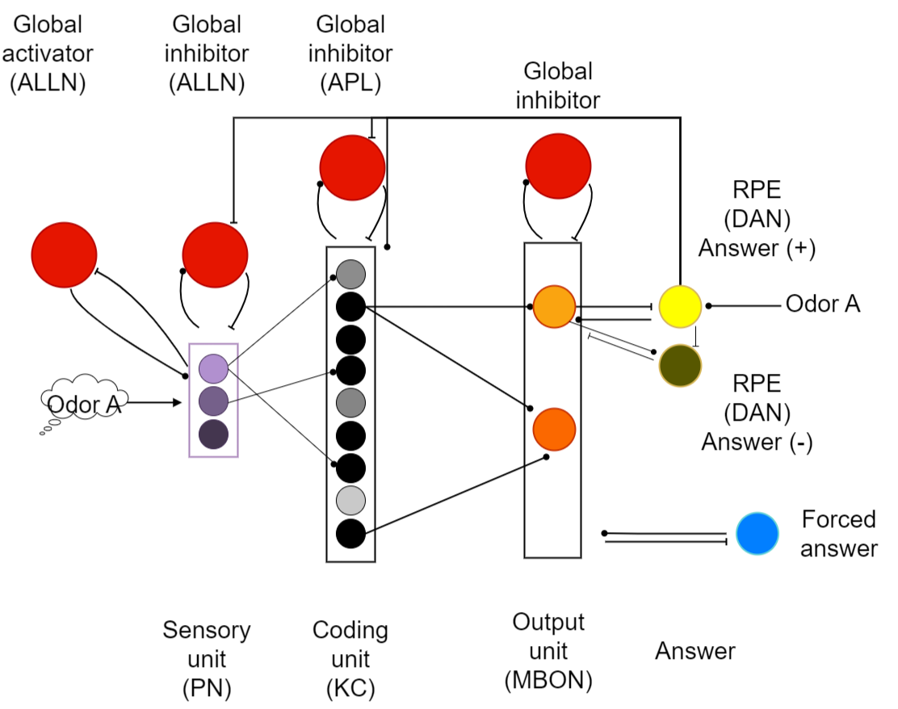

](../../assets/notion/model-v2/01-network-architecture.png)

Network architecture. The reported experiments use PN, KC, APL, MBON, MBON inhibition and a training-only teacher. ALLN activation/inhibition in the full schematic is inactive in these experiments. The DAN pathway remains under development; its presence in the drawing is not evidence of a completed dopamine-learning result.

## From an exposure to a reproducible input pattern

The KT Batch 1–3 corpus contains 8,366 cleaned exposures from a 14-channel metal-oxide array. Five devices were measured over 95 days between 6 March and 7 October 2020. Known faulty Batch 2 devices 1–2 were excluded, approximately 13% of the raw recordings. Four concentrations per gas and four humidity levels provide variation within the five classes.

| Class | Range |
| --- | --- |
| SO₂ | 10–100 ppm |
| NO₂ | 2–20 ppm |
| Toluene | 1–10 ppm |
| Ethanol | 5–40 ppm |
| NH₃ | 2–20 ppm |

Each recording alternates clean-air “Dilute” and gas-exposure “Test” segments. The channel baseline is the median of the last 60 readings in the preceding Dilute segment. We extract signed delta-median, delta-steady (the median of the last 60 Test readings minus baseline), and delta-peak (the signed deviation with greatest absolute magnitude), together with baseline-relative variants. The reported network uses one delta-peak per sensor: 14 values per exposure.

[

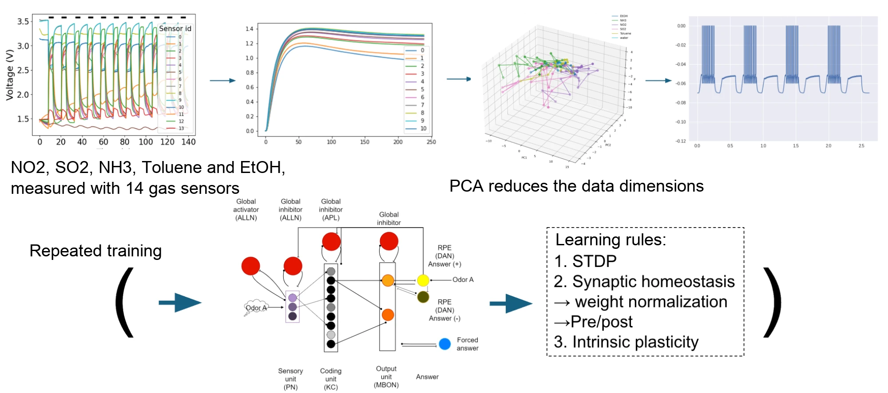

](../../assets/notion/model-v2/02-sensor-to-spike-workflow.png)

Computational workflow. A static response vector is extracted from each exposure, then presented to the network for 30 ms of simulated time. This is not the physical gas-exposure duration. Learning combines KC threshold adaptation, spike-pair updates and weight normalization.

[

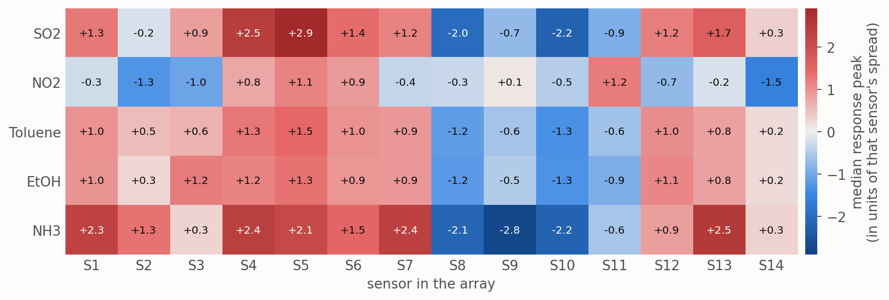

](../../assets/notion/model-v2/03-kt-gas-response-patterns.png)

Median peak response by gas and sensor across 8,366 KT exposures, expressed in each sensor’s spread units for visualization. NO₂ has distinct response directions, while toluene and ethanol have similar profiles. These summaries motivate the confusion analysis but do not measure classifier performance.

### Two datasets, two roles

The independent UCI-270 corpus provides a longer drift series: 13,910 measurements, 16 sensors, six gases, 128 features, ten batches and 36 months. It contains four sensors each of TGS2600, TGS2602, TGS2610 and TGS2620. The gases are ethanol, ethylene, ammonia, acetaldehyde, acetone and toluene. [[15]](../../model.html#ref-rodriguez-lujan-2014) [[21]](../../model.html#ref-uci-270) KT and UCI differ in class sets, feature dimensions and preprocessing; their scores are not interchangeable.

### Train-only PCA

Missing entries are median-imputed using training data. PCA is fitted on the training partition and held fixed for validation. [[10]](../../model.html#ref-jolliffe-2002) KT uses unstandardized peak responses and eight components; the first three explain approximately 94% of variance and the first eight 99.5% in the reported projection. Large-amplitude channels therefore contribute more strongly. The 8 × 14 projection is computationally small, but variance retention does not guarantee class separation or preservation of all pairwise distances.

[

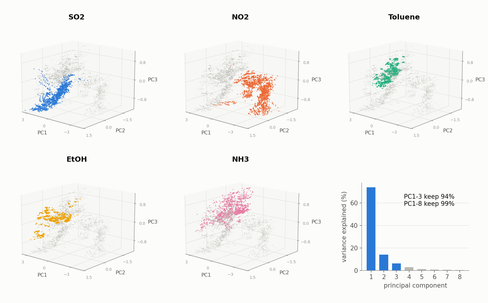

](../../assets/notion/model-v2/04-kt-pca-projection.png)

KT PCA projection. Gas panels share viewing angle and axis ranges. Toluene and ethanol occupy nearby regions; NH₃ is more dispersed. Explained variance summarizes the projection shown, not classification performance.

UCI features have very different scales. Training means and standard deviations standardize them before PCA; twenty components retain approximately 98% of variance and the first three retain 75%. Roughly 5% of extreme positions are omitted from the following plot to keep its central structure readable. This display choice does not establish a training exclusion.

[

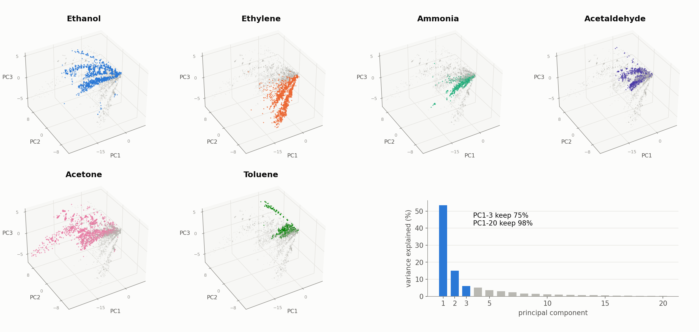

](../../assets/notion/model-v2/05-uci-pca-projection.png)

UCI PCA projection with extreme display positions omitted. Concentration changes tend to extend each gas along a response direction, while batches can occupy different directions. The twenty-component UCI configuration is distinct from the eight-component KT configuration.

### A bounded combinatorial PN code

Each PC axis is divided into twenty equal-width bins spanning its training range. A measurement activates one bin per axis; values beyond that range are clamped to an outer bin. For KT, eight components give 160 PN units, exactly eight receiving odor current. Similar exposures can share active bins, but quantization and clamping can also discard distinctions.

[

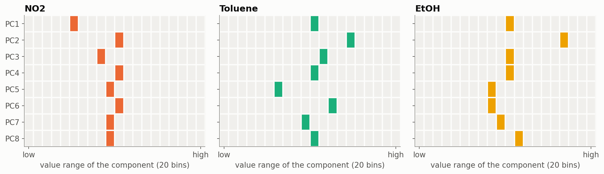

](../../assets/notion/model-v2/06-pn-binning-encoding.png)

PN encoding for representative NO₂, toluene and ethanol exposures. Each row selects one of twenty bins. This is a feature code inspired by a projection-neuron representation, not a reconstruction of individual fly glomeruli.

## Network dynamics and the learned readout

The network uses Brian2 conductance-based leaky integrate-and-fire neurons, AMPA-like excitation and GABA-like inhibition, and forward Euler integration at 0.1 ms. [[11]](../../model.html#ref-stimberg-2019) Neuronal state is reset between exposures. The receptor names describe model currents; this is a computational abstraction rather than a neurotransmitter-complete fly circuit.

C · dV/dt = gL(EL − V) + gAMPA(EAMPA − V) + gGABA(EGABA − V) + Iinput

dgx/dt = −gx/τx; on a presynaptic spike, gx ← gx + w

A neuron spikes on crossing threshold, resets to −60 mV and remains refractory for 1 ms. The 160 PNs project randomly to 1,000 KCs with connection probability 0.05, about eight PN inputs per KC. Incoming weights total 800 nS per KC. One APL receives from every KC and inhibits every KC; each direction uses 30 nS connections. Five MBONs, one per KT gas, receive from all KCs and inhibit one another.

### Activity regulates KC thresholds

The KC spike trace x rises by 0.1 per spike and decays with a 10 ms time constant. Active KCs raise their thresholds toward 0 mV; sufficiently quiet KCs relax toward −60 mV. This balances responsiveness and sparsity rather than fixing the active fraction in advance.

dVth/dt = ηx(Vmax − Vth) − κ(Vth − Vmin) · 1[x < 10−6]

η = 0.01 ms−1; κ = 10−4 ms−1; Vmin = −60 mV; Vmax = 0 mV

### Local potentiation with competition for a fixed total

Only KC→MBON synaptic weights learn. Pre- and postsynaptic traces decay over 5 ms; spike pairs increase weight by up to 0.025 nS. Both temporal orders potentiate, unlike classical asymmetric STDP. [[12]](../../model.html#ref-song-2000) After every training presentation, each KC’s five outgoing weights are normalized to a total of 10 nS, with individual weights within 0–10 nS. Strengthening one output therefore reduces the relative strength of the others.

During training, the correct-class teacher starts 1 ms after odor onset and drives its MBON; mutual inhibition suppresses competitors. During testing, the teacher and all learning are disabled. The MBON with the most spikes is the predicted class. This rule is biologically motivated, not a literal dopamine-gated fly implementation.

#### Complete KT parameters and units

| Parameter | Value | Scope |
| --- | --- | --- |
| Capacitance C | 300 pF | All neurons |
| Leak gL / reversal EL | 30 nS / −70 mV | Membrane time constant 10 ms |
| Threshold / reset | −40 mV / −60 mV | KC threshold subsequently adapts |
| Refractory period | 1 ms | All neurons |
| Excitatory reversal / decay | 0 mV / 2 ms | AMPA-like current |
| Inhibitory reversal / decay | −80 mV / 5 ms | GABA-like current |
| KC trace | +0.1 per spike; τ = 10 ms | Threshold adaptation |
| KC threshold bounds | −60 to 0 mV | Initially −40 mV |
| KC η / κ | 0.01 / 0.0001 ms⁻¹ | η = 0.005 × IP factor 2; recovery below trace 10⁻⁶ |
| Integration | Euler; Δt = 0.1 ms | State reset between exposures |

| Connection | Weight / total | Learning |
| --- | --- | --- |
| PN→KC | p = 0.05; incoming sum 800 nS / KC | Fixed random projection |
| KC→APL | 30 nS per synapse | Fixed; all KCs |
| APL→KC | 30 nS per synapse | Fixed; all KCs |
| KC→MBON | Outgoing sum 10 nS / KC; individual 0–10 nS | Pair potentiation ≤0.025 nS; τ = 5 ms; normalize after exposure |
| Teacher→MBON | 1,500 nS | One-to-one; training only |
| MBON→teacher | 200 nS inhibitory | One-to-one feedback |
| Different MBONs | 2,000 nS inhibitory | Fixed mutual inhibition |

| Setting | KT value |
| --- | --- |
| Odor current | 2.05 nA in eight active PNs for 30 ms |
| Teacher current | 10 nA in the correct teacher, beginning 1 ms after odor onset |
| Exposure / gap | 30 ms / 3 ms |
| Training | 300 cycles × five gases = 1,500 sampled presentations |
| Testing | 50 sampled presentations / gas = 250; learning frozen |

## Separate random, day-held-out and chronological tests

KT evaluation uses five folds under two strategies. A gas-stratified random split mixes measurement days across training and testing. A whole-day split keeps each day intact, so test days are unseen. Imputation, scaling where applicable, PCA and bin edges are fitted to training data. Training comprises 300 cycles, each presenting every gas once; testing uses fifty presentations per gas with frozen learning.

The corpus unit is an exposure; a sampled presentation is a simulation trial. Repeated draws from an exposure do not create independent measurements. Macro-F1 is the unweighted mean of classwise F1 scores; accuracy is the fraction classified correctly. The metrics remain distinct throughout.

| Study | Dataset / split | Reported scale |
| --- | --- | --- |
| Main SNN comparison | KT random / whole-day five-fold | Fold means; random macro-F1 0.87 ± 0.03 |
| Sensitivity | KT one random split; one run per setting | 250 sampled test presentations; baseline F1 0.868 |
| Layer diagnosis | KT one common random split | 6,692 train / 1,674 held-out exposures |
| Offline readout rules | UCI KC representations; five folds | Macro-F1; mean and fold spread |
| Reference calibration | UCI train Batch 1, test later batches | Accuracy averaged over Batches 2–10 |
| Continual learning | KT four gases, then NH₃ only | One run; fraction correct per class |

The fold plots label their uncertainty as “spread”; the source does not specify whether ±0.03 denotes standard deviation or another statistic. We therefore report fold variation, not a confidence interval. New-run seeds, fold assignments and machine-readable predictions are not included. Parameter sweeps selected settings, but a separate nested selection protocol is undocumented; these estimates do not establish performance on a completely untouched deployment population.

## Classification succeeds unevenly across the five gases

Under stratified random five-fold evaluation, KT mean macro-F1 is 0.87 with reported variation ±0.03; the source separately reports approximately 88% accuracy. This extends the earlier single-run 0.868 baseline without implying an identical seed or test partition.

### The dominant error is toluene → ethanol

In the illustrated classwise result, NO₂ recall is 98%. Toluene recall is 60%, with 24% assigned to ethanol, consistent with their similar sensor profiles. The illustrated F1 scores are SO₂ 0.88, NO₂ 0.93, toluene 0.73, ethanol 0.83 and NH₃ 0.83; these are not the five-fold class means.

[

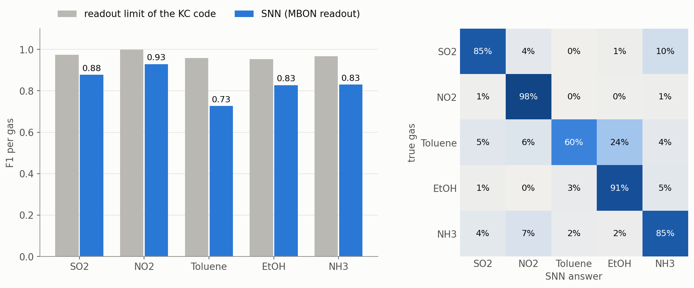

](../../assets/notion/model-v2/07-kt-classification-confusion.png)

Classwise performance and confusion. Rows are true classes and columns predicted classes; percentages are row-normalized. Grey bars are an empirical RBF-SVM probe of KC activity, not a proven upper bound. The KC code supports toluene F1 near 0.96, motivating readout diagnosis.

### A sparse response precedes the decision

Eight PN units receive current per KT exposure. KC activity is initially stronger, then APL inhibition suppresses it after approximately 5 ms; the source reports about 11% active KCs on average. Four of the five illustrated trials are correct, while toluene is classified as ethanol. These examples explain dynamics rather than provide an independent accuracy estimate.

[

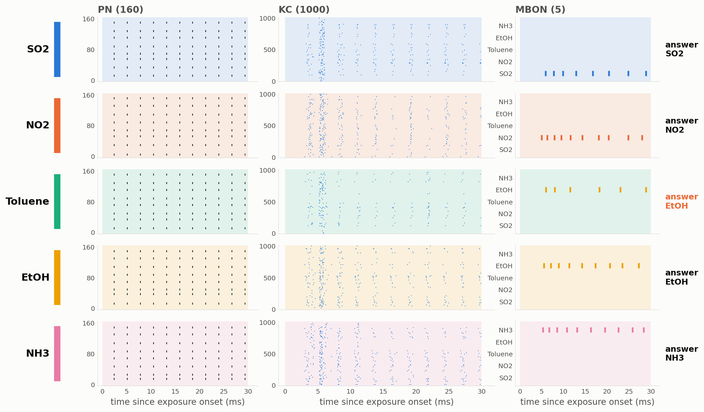

](../../assets/notion/model-v2/08-layer-spike-rasters.png)

Spike rasters over 30 ms for one example per gas. Sparse KC responses and competing MBON activity are visible, including a toluene-to-ethanol error.

## The split reveals what the network has not learned

### Unseen days reduce macro-F1 to 0.73

Gas identity is strongly associated with the 95 KT measurement days: almost every day contains only one gas, and no day has more than two. Random splitting can share day-specific conditions across training and test data. Keeping days intact is more stringent: SNN mean macro-F1 decreases from 0.87 to 0.73.

### Compare classifiers under the same split question

| Classifier / input | Random macro-F1 | Whole-day macro-F1 |
| --- | --- | --- |
| RBF SVM / eight PCs | 0.99 | 0.90 |
| Linear SVM / PN code | 0.96 | 0.84 |
| SNN / MBON output | 0.87 | 0.73 |

[

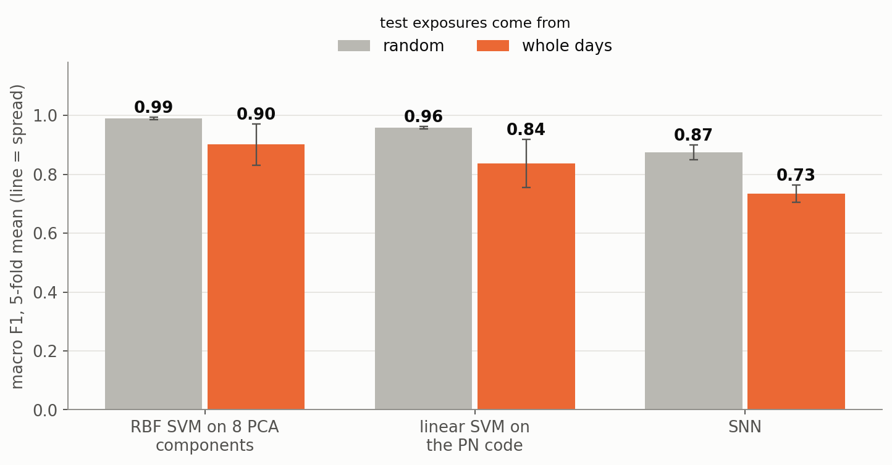

](../../assets/notion/model-v2/09-random-versus-day-splits.png)

Bars are five-fold means; lines show source-reported fold spread, without a specified SD/SE definition. SNN loses about 0.14 macro-F1; the SVM comparisons lose about 0.09 and 0.12. This is not a chronological SNN drift evaluation.

**Design consequence.** Future collection should interleave multiple gases within each day, randomize order, and retain device, humidity, concentration and time metadata. Whole-day holdout is informative but cannot isolate aging from all day-to-day changes.

### Sensitivity identifies parameters worth controlling

A one-at-a-time sweep varies parameters around the selected KT setting. Most changes of approximately 30–50% alter macro-F1 by less than 0.05. The KC→MBON weight limit and PN bin count have the largest effects; halving KC threshold adaptation decreases F1 by approximately 0.07. Each setting has one run and 250 sampled test presentations, so small differences need repetition before being called improvements.

[

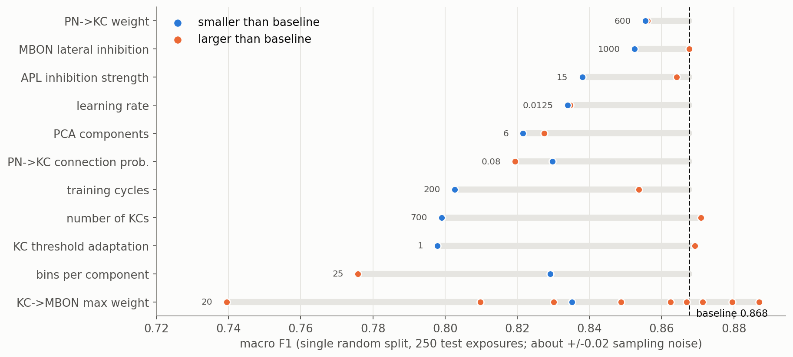

](../../assets/notion/model-v2/10-parameter-sensitivity.png)

The dashed line is the earlier single-run 0.868 reference. The plot’s approximate ±0.02 sampling-noise annotation is a heuristic, not a documented confidence interval. Parameter sensitivity does not replace controlled ablations or temporal testing.

## Most separable information survives until the readout

Conventional probes were trained on sensor, PCA, PN and KC representations using the same 6,692 training and 1,674 held-out KT exposures. RBF-SVM scores remain about 0.99 on raw sensor features and PCA, and 0.97 on PN and KC codes. The learned MBON output scores 0.84 in this diagnostic split: a 0.13 gap from the KC probe.

[

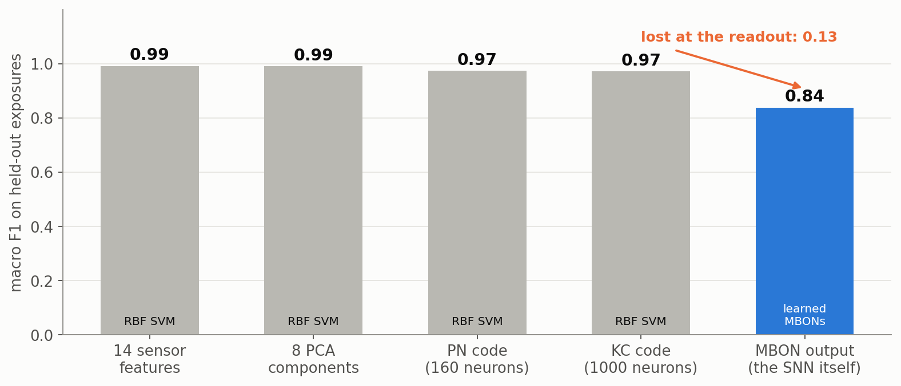

](../../assets/notion/model-v2/11-layer-readout-diagnosis.png)

Common-split diagnosis. Nonlinear probes remain strong through KC activity, while the learned MBON stage loses 0.13 macro-F1. The 0.84 diagnostic result is distinct from the five-fold headline 0.87.

Linear-probe F1 improves only slightly from PN 0.96 to KC 0.97. Restricting a KC classifier to the 1,355 unique exposures actually encountered by sampled SNN training still gives about 0.95. These comparisons prioritize the learning/readout stage without proving that every upstream choice is optimal.

### Error-driven updates are a promising next comparison

Offline UCI tests hold KC representations fixed. The current Hebbian rule with normalization reaches about 0.81 macro-F1; class averaging gives 0.80, adding depression after wrong answers gives 0.82, and error-driven variants reach 0.84–0.85. A linear-SVM probe reaches 0.89. Dopamine-dependent mushroom-body learning motivates error-sensitive updates, but biological reinforcement is more heterogeneous than a single correction signal. [[17]](../../model.html#ref-aso-2016) [[18]](../../model.html#ref-jiang-2021) [[20]](../../model.html#ref-cassenaer-2012)

[

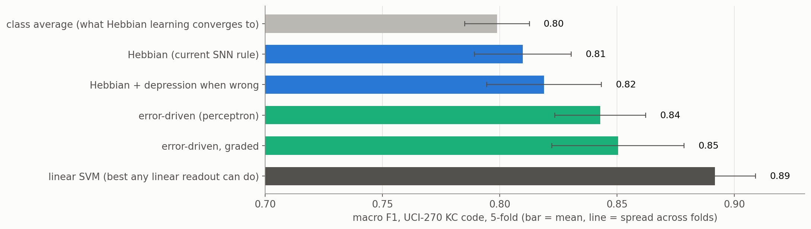

](../../assets/notion/model-v2/12-offline-learning-rule-comparison.png)

Offline readout comparison: five-fold means and reported fold spread. The plot’s “best any linear readout can do” label denotes the tested linear-SVM benchmark, not a mathematical bound. The improved offline rules have not yet shown the same gain in the full spiking network.

## Drift changes the pattern, not only its overall scale

UCI concentration-corrected gain is compared with Batch 1 on a log₂ scale: +1 is a twofold gain and −1 a halving. For most gases, the median response gain across the sixteen sensors is about 1.2–2.3 times the initial value in Batches 2–9; by the 36-month batch, all six gas medians fall below their initial level. Four TGS2602 sensors differ from the other twelve: acetaldehyde, acetone and toluene responses become approximately 4–11 times weaker from Batch 2; one response is nearly silent around months 21–23. Drift depends on gas and is larger at low concentrations.

[

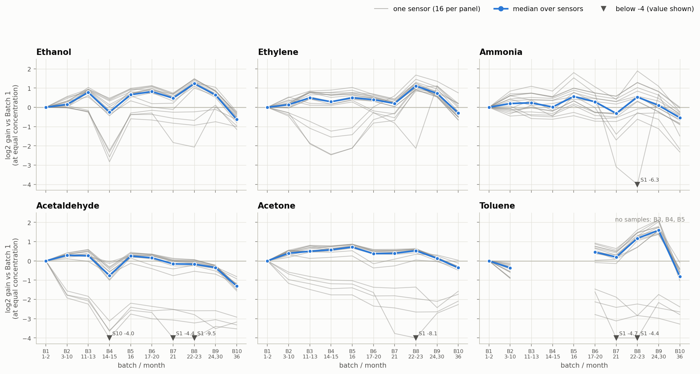

](../../assets/notion/model-v2/13-uci-concentration-corrected-drift.png)

Thin traces denote individual sensors and blue denotes their median. Missing gas–batch combinations remain absent. This is a characterization of the dataset, not an SNN accuracy result.

| Component | Share | Reference-gas interpretation |
| --- | --- | --- |
| Global shift | 7% | Shared factor |
| Sensor-model shift | 55% | Model-specific factors needed |
| Individual sensor | 7% | Sensor-specific factors needed |
| Gas × sensor | 31% | One gas cannot identify all gas-specific changes |

[

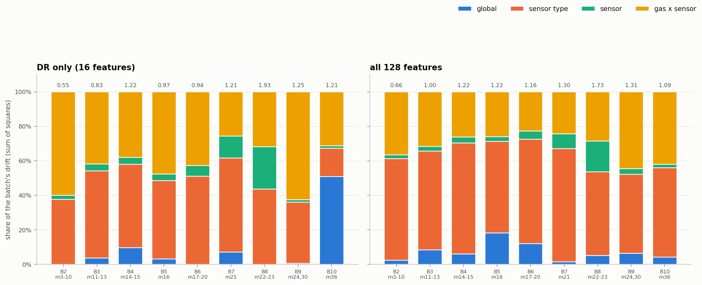

](../../assets/notion/model-v2/14-uci-drift-decomposition.png)

Drift decomposition for ΔR and all 128 features; total RMS log₂ gain is shown above each bar. The shared components sum to 69%, suggesting a reference-gas correction opportunity under this decomposition. It is not a measured 69% accuracy recovery.

### Aging and concentration coverage both matter

Within-batch SVM accuracy is about 99%. Training on Batch 1 and testing later batches gives about 33% mean accuracy; training on the preceding batch gives about 71%. More than 90% of Batch 10 samples fall outside Batch 9’s concentration range. Restricting comparisons to in-range concentrations changes several results, so the unrestricted loss cannot be attributed entirely to sensor aging.

[

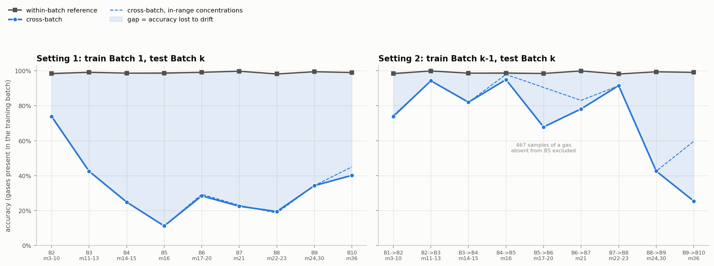

](../../assets/notion/model-v2/15-uci-cross-batch-svm.png)

Within-batch, unrestricted cross-batch and concentration-matched curves answer different questions. The plotted preceding-batch study excludes 467 samples of a gas absent from its training batch; class coverage therefore also affects comparison.

### Ten ethanol measurements recover part of the loss

Ten ethanol references per new batch, with separate feature corrections, raise mean Batch 1→later-batch SVM accuracy from 33% to 58%. This recovers 25 of the approximately 66 percentage points separating the uncorrected score from the within-batch reference. A global correction gives 34%, and normalizing each sample gives 43%. Related domain-adaptation methods likewise use labeled target-domain samples. [[16]](../../model.html#ref-zhang-2015)

[

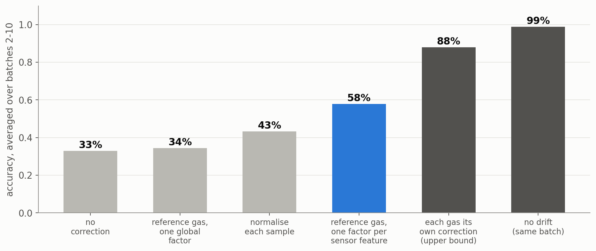

](../../assets/notion/model-v2/16-uci-reference-gas-calibration.png)

Mean SVM accuracy over Batches 2–10. The practical reference condition uses ten ethanol measurements from each new batch. Gas-specific correction uses extra information about every gas; its 88% is an optimistic comparator, not an ethanol-only result or a universal upper bound.

A reference-gas route is therefore worth evaluating in the reader. These results do not establish inherent SNN drift resistance. The decisive tests remain KT Batch 1→Batches 2–3 and UCI Batch 1→later / previous→next SNN evaluations, each with and without reference correction.

## A new gas can be added, with a measurable cost

Sequential learning can interfere with earlier knowledge. [[19]](../../model.html#ref-mccloskey-1989) In an initial KT experiment, the network learns four gases and then receives ten cycles of NH₃ alone, without rehearsal of the old gases.

[

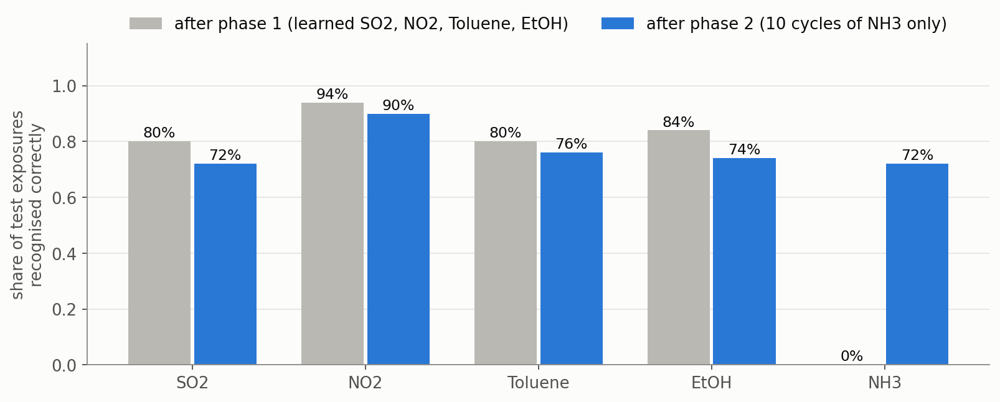

](../../assets/notion/model-v2/17-continual-learning-single-run.png)

One sequential-learning run. NH₃ recognition changes from 0% to 72%; SO₂ 80%→72%, NO₂ 94%→90%, toluene 80%→76%, ethanol 84%→74%. These are fractions correct per class, not macro-F1.

The four old classes lose 4–10 percentage points while retaining most of their initial performance. This is partial retention in one run, not a general solution to forgetting. Sparse KC overlap is a possible mechanism, but overlap was not quantified here. Multiple seeds, class orders and conventional sequential-learning baselines are needed.

### The teacher schedule prevents the proposed error signal

A dopamine-inspired rule was implemented to weaken connections to a wrong MBON, but this weakening does not currently trigger: the correct teacher acts early and inhibition prevents competitors from answering first. The next design adds a free-response phase before a delayed teacher. No full-network classification or retention improvement has yet been reported for that design.

## What this changes for AeroSense

The practical lesson is to vary collection conditions independently before replacing the classifier. Record gas, device, concentration, humidity and day; interleave gases within days; evaluate feature-specific reference correction; and compare readout changes on fixed exposure partitions before increasing network size.

Transfer to AeroSense requires labeled odor-evoked HEK293 response traces, blanks and reference conditions, replicate cultures, and measurements across devices and time. Transfection fluorescence supports expression-related observations; it is not yet a gas-classification dataset. The physical models address obtaining a signal, while the decoder study addresses classification of an independent sensor-array signal.

The source describes an integer-arithmetic implementation. A reproducible engine package, numerical agreement report and measured latency, memory or power results are not supplied with these figures. The scores remain simulation benchmarks and do not establish an embedded-device specification.

## Reproduction record and analysis boundaries

The figures and settings provide an inspectable analysis record. Independent reproduction also needs the input table, fold membership, sampling seeds, implementation and resolved configurations. The source describes versioned TOML presets and spike/prediction logs, but those decoder artifacts are absent from the supplied release; this is separate from the available physical-simulation archives.

### Additional KT transfer observations

The team record also reports conventional-classifier scores of approximately 0.62–0.77 when training on KT Batch 1 and testing on Batches 2–3, and approximately 0.87 on Batch 3 after adaptation with a few labeled target-domain samples. The associated classifier identity, scoring metric, split details and target-sample budget are not specified. These remain provisional transfer observations; they cannot be treated as SNN macro-F1, directly compared with the UCI accuracy results, or used to establish an adaptation effect size.

#### Fold-safe workflow

exclude documented faulty devices
split exposures by gas-stratified folds OR whole measurement days
for each training fold:
    fit medians; scale only where required
    fit PCA; derive bins from training ranges
    initialize fixed PN-KC projection and plastic readout
    train 300 cycles x 5 gases; adapt thresholds and readout
    freeze learning; disable teachers
    score held-out presentations; retain unique exposure IDs
report fold metrics, confusion, seeds and split membership

#### Required records for an independent rerun

| Record | Available | Required for a rerun |
| --- | --- | --- |
| Dataset | Counts, cleaning and feature definitions | KT thesis citation, release authorization, exact features |
| Preprocessing | Train-only protocol | Fitted medians, scales, PCA and bins per fold |
| Network | Equations, units, weights and schedule | Executable code, versions and resolved presets |
| Evaluation | Seventeen figures and reported metrics | Fold IDs, new-run seeds, exposure IDs and predictions |
| Uncertainty | Fold means and reported spread | Spread definition, fold values and separate seed replication |
| Deployment | Source description of integer implementation | Engine, numerical agreement and device benchmarks |

## A narrower claim makes the next experiment clearer

### Generalization is more than five folds

Five-fold evaluation extends a single-run result but does not quantify all variation from connectivity, initialization and presentation order. Vary those sources independently on fixed exposure partitions, define the fold-spread statistic, and document whether parameter selection reused evaluation data.

### Separate motif tests from parameter sweeps

One-at-a-time sensitivity does not isolate the contribution of APL, KC expansion or intrinsic plasticity. Matched ablations should control training budget and test exposures. The strong PN linear probe makes a simpler direct readout an essential comparator.

Offline error-driven gains must be reproduced in the spiking network. A delayed-teacher test should measure both classification and retention across seeds and class orders. Chronological evaluation must separate concentration extrapolation, absent classes and drift. Finally, a metal-oxide benchmark cannot establish the noise, dynamics or stability of a cell-based reader; that requires AeroSense measurements.

## Resolve the limiting step in each track

The physical models identify finite optical collection and unresolved delivery from the gas interface to bottom-attached cells. The decoder reaches KT random-split macro-F1 0.87 ± 0.03 but falls to 0.73 on unseen days. Layerwise probes localize the largest measured loss to the learned readout, while UCI reference calibration recovers part of a conventional classifier’s cross-batch loss.

These results prioritize liquid-delivery validation, detector calibration, diverse collection schedules, split-resolved decoder artifacts and error-driven learning under chronological evaluation. They guide experiments; they are not yet an end-to-end biological odor-recognition demonstration.

## Figures, datasets and reproducibility materials

All figures open at their supplied full resolution. The analysis source is the team’s [Model (2) record](https://jealous-ragdoll-815.notion.site/3f5256561ff881dc9639e30f58948e42). Independent reproduction requires the code, split tables and predictions identified below.

The [UCI-270 dataset](https://archive.ics.uci.edu/dataset/270/gas+sensor+array+drift+dataset+at+different+concentrations) includes concentration and batch metadata. [[21]](../../model.html#ref-uci-270) KT is identified as a doctoral-thesis dataset, but its full citation and redistribution permission are not supplied; no raw KT download is offered. Decoder code, fitted preprocessing, fold tables, new-run seeds and machine-readable predictions are not included.

The independent physical calculations retain their [source and figure index](../../hardware%20information/AeroSense%20v2/handoff_EN.md) and [reproducibility and assembly packages](../../hardware.html#build-package). Their 100 µL simulation fill remains unchanged; the provisional 80 µL physical volume has not been resimulated.

        

## References

        
          

### Research papers

          
            
- Marco, S., & Gutiérrez-Gálvez, A.
            (2012).
            Signal and data processing for machine olfaction and chemical sensing: A review.
            *IEEE Sensors Journal*, 12(11), 3189–3214.
            
          [ Source ↗](https://doi.org/10.1109/JSEN.2012.2192920)
            
- Vergara, A., Vembu, S., Ayhan, T., Ryan, M. A., Homer, M. L., & Huerta, R.
            (2012).
            Chemical gas sensor drift compensation using classifier ensembles.
            *Sensors and Actuators B: Chemical*, 166–167, 320–329.
            
          [ Source ↗](https://doi.org/10.1016/j.snb.2012.01.074)
            
- Turner, G. C., Bazhenov, M., & Laurent, G.
            (2008).
            Olfactory representations by Drosophila mushroom body neurons.
            *Journal of Neurophysiology*, 99(2), 734–746.
            
          [ Source ↗](https://doi.org/10.1152/jn.01283.2007)
            
- Caron, S. J. C., Ruta, V., Abbott, L. F., & Axel, R.
            (2013).
            Random convergence of olfactory inputs in the Drosophila mushroom body.
            *Nature*, 497, 113–117.
            
          [ Source ↗](https://doi.org/10.1038/nature12063)
            
- Lin, A. C., Bygrave, A. M., de Calignon, A., Lee, T., & Miesenböck, G.
            (2014).
            Sparse, decorrelated odor coding in the mushroom body enhances learned odor discrimination.
            *Nature Neuroscience*, 17(4), 559–568.
            
          [ Source ↗](https://doi.org/10.1038/nn.3660)
            
- Aso, Y., et al.
            (2014).
            Mushroom body output neurons encode valence and guide memory-based action selection in Drosophila.
            *eLife*, 3, e04580.
            
          [ Source ↗](https://doi.org/10.7554/eLife.04580)
            
- Dasgupta, S., Stevens, C. F., & Navlakha, S.
            (2017).
            A neural algorithm for a fundamental computing problem.
            *Science*, 358(6364), 793–796.
            DOI: [10.1126/science.aam9868](https://doi.org/10.1126/science.aam9868).
            
- Schmuker, M., & Schneider, G.
            (2007).
            Processing and classification of chemical data inspired by insect olfaction.
            *Proceedings of the National Academy of Sciences*, 104(51), 20285–20289.
            
          [ Source ↗](https://doi.org/10.1073/pnas.0705683104)
            
- Imam, N., & Cleland, T. A.
            (2020).
            Rapid online learning and robust recall in a neuromorphic olfactory circuit.
            *Nature Machine Intelligence*, 2, 181–191.
            
          [ Source ↗](https://doi.org/10.1038/s42256-020-0159-4)
            
- Stimberg, M., Brette, R., & Goodman, D. F. M.
            (2019).
            Brian 2, an intuitive and efficient neural simulator.
            *eLife*, 8, e47314.
            DOI: [10.7554/eLife.47314](https://doi.org/10.7554/eLife.47314).
            
- Song, S., Miller, K. D., & Abbott, L. F.
            (2000).
            Competitive Hebbian learning through spike-timing-dependent synaptic plasticity.
            *Nature Neuroscience*, 3(9), 919–926.
            
          [ Source ↗](https://doi.org/10.1038/78829)
          
- Babadi, B., & Sompolinsky, H. (2014). Sparseness and expansion in sensory representations. Neuron, 83(5), 1213–1226. [Source ↗](https://doi.org/10.1016/j.neuron.2014.07.035)

#### Source highlights

Expansion and sparseness can amplify within-class variability; they do not guarantee robustness.
- Litwin-Kumar, A., Harris, K. D., Axel, R., Sompolinsky, H., & Abbott, L. F. (2017). Optimal Degrees of Synaptic Connectivity. Neuron, 93(5), 1153–1164.e7. [Source ↗](https://doi.org/10.1016/j.neuron.2017.01.030)

#### Source highlights

Relates synaptic degree, representation dimension and associative readout performance.
- Rodríguez-Luján, I., Fonollosa, J., Vergara, A., Homer, M., & Huerta, R. (2014). On the calibration of sensor arrays for pattern recognition using the minimal number of experiments. Chemometrics and Intelligent Laboratory Systems, 130, 123–134. [Source ↗](https://tsapps.nist.gov/publication/get_pdf.cfm?pub_id=914227)

#### Source highlights

Examines calibration sampling and concentration coverage; a requested UCI source citation.
- Zhang, L., & Zhang, D. (2015). Domain Adaptation Extreme Learning Machines for Drift Compensation in E-nose Systems. IEEE Transactions on Instrumentation and Measurement, 64(7), 1790–1801. [Source ↗](https://arxiv.org/abs/1505.06405)

#### Source highlights

Uses limited labeled target-domain data, distinct from a zero-calibration claim.
- Aso, Y., & Rubin, G. M. (2016). Dopaminergic neurons write and update memories with cell-type-specific rules. eLife, 5, e16135. [Source ↗](https://doi.org/10.7554/eLife.16135)

#### Source highlights

Dopaminergic cell types modify memories under distinct timing-dependent rules.
- Jiang, L., & Litwin-Kumar, A. (2021). Models of heterogeneous dopamine signaling in an insect learning and memory center. PLOS Computational Biology, 17(8), e1009205. [Source ↗](https://doi.org/10.1371/journal.pcbi.1009205)

#### Source highlights

Models heterogeneous dopamine signals, rather than one shared scalar error.
- McCloskey, M., & Cohen, N. J. (1989). Catastrophic interference in connectionist networks: The sequential learning problem. Psychology of Learning and Motivation, 24, 109–165. [Source ↗](https://doi.org/10.1016/S0079-7421(08)60536-8)

#### Source highlights

Introduces the sequential-learning interference problem motivating retention tests.
- Cassenaer, S., & Laurent, G. (2012). Conditional modulation of spike-timing-dependent plasticity for olfactory learning. Nature, 482, 47–52. [Source ↗](https://doi.org/10.1038/nature10776)

#### Source highlights

Locust experiments connect timing-dependent plasticity and neuromodulation; biological context, not direct validation of this fly-inspired model.
- Vergara, A. (2012). Gas Sensor Array Drift at Different Concentrations [Dataset]. UCI Machine Learning Repository. [Source ↗](https://doi.org/10.24432/C5MK6M)

#### Source highlights

13,910 measurements, 16 sensors, six gases, 128 features, ten batches and concentration metadata across 36 months.
        
        
          

### Other sources

          
            
- Jolliffe, I. T.
            (2002).
            Principal Component Analysis
            (2nd ed.). Springer.
            
          [ Source ↗](https://doi.org/10.1007/b98835)
          
        
      
